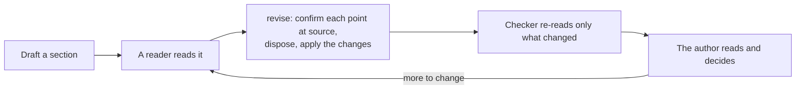

# ai-agent-science

Agent skills for a scientist who writes a journal paper with an AI agent and wants every checkable sentence to be verifiable. The toolkit is Markdown that tells the agent how to work, two small Python tools (one for the literature, one for the traces) and one LaTeX package. It works in any agent harness that reads `SKILL.md` skills.

## The idea

A paper is verifiable when every checkable sentence has its source beside it, or a visible gap where the source is missing, and when someone other than the writer has opened those pointers. An agent writes fast and cannot see its own errors, and the author's attention is the scarce resource. So the toolkit makes the unverified visible, keeps what the author must read short, and never certifies anything itself. The author is the gate.

The mechanism is one comment beside each checkable sentence in the manuscript source, or a gap that prints loudly in a draft and fails the build in final mode:

```latex
% src: notes/2026-03-02-run-log.md "converged after 200 iterations"
The fit converged after 200 iterations.

The residual is below the noise \gap{number}{command that would measure the residual}.
```

## How a paper is written with it

The `paper` skill is a map of what a scientist does, not a pipeline: the stages are not in order, none is a gate, and a paper returns to most of them many times.

| Stage | What happens | Read | Status |
|---|---|---|---|
| Orient | The workspace is made, the material is read, the author is asked why the work was done, and an argument is proposed for the author to correct | `start.md` | built |
| Position | The paper's place in the literature and its journal | the `literature` skill, `techniques/field.md`, `techniques/venue.md` | built |
| Evidence | Each claim is tested against what it rests on, and what is missing is found | `readers/challenger.md` | the challenger is built; the `evidence` skill is planned |
| Draft | One section at a time, from sources opened in that session, with a paragraph plan first and a trace or gap beside each checkable sentence | `draft.md`, `sections.md`, the workspace's `paper/style.md` | built |
| Verify | A fresh context re-opens every trace and compares it with the sentence | `review.md`, `readers/checker.md` | built |
| Style and shape | The whole is read as an editor would and reshaped | the stylist brief | planned; briefed by hand from `review.md` until then |
| Referee | The paper is attacked as a journal's referee would, one fresh context per angle, against the field's accepted practice and the journal's referee guidelines | `readers/referee.md` | built |
| Finish | The final-mode build, an audit sheet of traces drawn by the tool, the submission bundle | `finish.md` | planned |
| Respond | Answering the journal's referee and co-authors | `revise.md`, and the reply letter at submission | `revise` built; the letter planned |

All feedback goes through one loop. Whoever reads the paper, the checker, the challenger, the stylist, a simulated referee, the author with a red pen or the journal's own referee, produces comments on it. `revise` splits them into numbered points, confirms each at source, records a disposition for each (accept, accept with a different change, decline with the reason, or leave to the author), applies the changes, and sends only what changed back to the checker.



The readers are briefs handed to a fresh context that did not write the text. The checker asks whether each sentence says what its source says. The challenger asks whether a claim, as worded, follows from its test. The referee judges the paper against its field and its journal.

## What every session relies on

**The core** (`skills/_shared/core.md`) is read whole by every session and every subagent. It holds eight rules: trace or gap; references are exported, never composed; the writer does not check itself; a claim is worded no stronger than its test; the author owns the argument and their prose; read, do not run, with one exception; shorter, and never by silent omission; and memory. It also holds the trace forms, the gap kinds, and how the author's words are sorted into testimony, direction and standing instruction.

**The workspace** is the paper's own git repository and the working directory of every session; `skeleton/workspace/` is the scaffold. Three files carry the contract and every drafter reads them:

- `AGENTS.md` says how we work here, names the installation root, sets the commit policy, and holds the `sources` block: which roots the paper may cite, at which version, and which it may not.
- `paper/outline.md` holds the intent in the author's words, the argument, and each section's role, budget and what it must carry.
- `paper/style.md` holds the register, notation and defined terms.

Five memory files keep apart what is true today (`STATE.md`, rewritten each session), what the paper argues (`outline.md`), what each claim rests on (`claims.md`), what the author must decide (`open-questions.md`) and what was decided and why (`journal.md`, append-only). Three reference files, `style.md`, `venue.md` and `field.md`, are each built once at first need by a technique, so that they are current for this paper, and are never a source. Each milestone review leaves a record in `paper/reviews/`.

**The check stamp**, `% checked: <date> <reader>`, is one comment line near the top of a section file, written once the checker has re-read what `revise` changed. `tools/traces.py stale` reports every file changed since its stamp.

## The tools

- `tools/ads.py` searches ADS/SciX and exports BibTeX byte for byte. It needs an [ADS/SciX API token](https://ui.adsabs.harvard.edu/user/settings/token).
- `tools/traces.py` is run from the workspace root. `list` collects every trace and gap; `lost` names each trace that disappeared or moved in a change; `lint` checks anchors, pins, paths and citation keys; `stale` reports sections changed since their last independent check.
- `skeleton/workspace/manuscript/scipaper.sty` is the gap macro.

Both tools use only the Python standard library. A paper also needs `latexmk` and git.

The `literature` skill answers five questions through `ads.py`: has this been done, what is the closest prior work and what did it leave open, what supports or contradicts one claim, what comparison values can be taken and with which conventions, and where a dataset or tool came from. It keeps a notebook of what was read, in the workspace's `paper/lit/`.

## Installation

Install once, globally. Clone this repository and link each `skills/<name>/` that holds a `SKILL.md` into the harness's skills directory (a catalogue script may do the linking). `skills/_shared/` is data the skills read and is not linked. The installation root, which holds `skills/`, `skeleton/` and `tools/`, is written once in each workspace's `AGENTS.md`. To develop, edit and commit in a separate clone, then bring the installed copy forward with `git pull --ff-only` in it. Never edit the installed copy.

## Starting a paper

Ask the agent to start one. It follows `skills/paper/start.md`: it copies the scaffold to a new directory, makes it a git repository, links the sources in, and asks why the work was done and who the paper is for before it proposes anything. Commands such as `/paper draft` are shortcuts where a harness offers them; plain conversation works everywhere, and a session that was never given a command starts in the right place by reading `paper/STATE.md`.

## What is planned

Each piece below is built when its case arrives, and [`docs/design.md`](docs/design.md) section 8 gives the trigger for each: the stylist brief, the `evidence` skill (how a claim with nothing under it becomes a question with a declared test, and the form in which a campaign's findings come back), `finish.md` with the audit sheet and the reply letter, a figures technique and a co-authors technique.

## Design

The reasons for the shape, what is deliberately left out, how components are tested and the decisions settled so far are in [`docs/design.md`](docs/design.md).

## Licence

MIT
