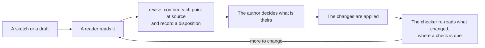

# ai-agent-science

Agent skills for a scientist who writes a journal paper with an AI agent and wants every checkable sentence to be verifiable. The toolkit is Markdown that tells the agent how to work, two small Python tools (one for the literature, one for the traces) and one LaTeX package. It works in any agent harness that reads `SKILL.md` skills.

It works beside the science, which is often unfinished when the writing starts: what the paper cannot yet say becomes a list of questions for the scientist to act on. Its parts also work alone, outside any paper.

## The idea

A paper is verifiable when four things hold: every checkable sentence has its source beside it, reached in one step, or a visible gap where the source is missing; a gap fails the final build; someone other than the writer has opened each source and compared it with the sentence, and the record says when and at which version of the text; and the author can audit a sample of sentences beside their sources in minutes, and see which text has changed since it was checked. An agent writes fast and cannot see its own errors, and the author's attention is the scarce resource. So the toolkit makes the unverified visible, keeps what the author must read short, and never certifies anything itself. The author is the gate.

The mechanism is one comment beside each checkable sentence in the manuscript source, or a gap that prints loudly in a draft and fails the build in final mode:

```latex
% src: notes/run-log.md "converged after 200 iterations"
The fit converged after 200 iterations.

The residual is below the noise \gap{number}{command that would measure the residual}.
```

## The four skills

| Skill | What it does | Alone? |
|---|---|---|
| `paper` | Writes a paper in its own workspace, from the first questions to the reply to the journal's referee. It calls the other three. | needs a workspace, which it makes |
| `literature` | Answers five questions through ADS/SciX: has this been done, what is the closest prior work and what did it leave open, what supports or contradicts one claim, what comparison values can be taken and with which conventions, and where a dataset or tool came from. Exports BibTeX from an authority. | yes; the notebook is optional |
| `readers` | Four independent readers, each a brief for a fresh context that did not write what it reads: a checker, a challenger, a referee and a stylist. | yes, on any document, claim or result |
| `frame` | Turns an idea into a question that could be answered: the claim as one testable sentence, what it rests on and what is missing, what the literature says, two or three framings, and the declared test. | yes; no workspace |

## How a paper is written with it

The `paper` skill is a map of what a scientist does, not a pipeline: the stages are not in order, none is a gate, and a paper returns to most of them many times.

| Stage | What happens | Read |
|---|---|---|
| Orient | The workspace is made, the material is read, the author is asked why the work was done and what is still open, and an argument is proposed for the author to correct | `skills/paper/start.md`, `skills/frame/SKILL.md` |
| Position | The paper's place in the literature, its field's norms, its journal and, if the author wants one, a style sheet of their voice | the `literature` skill, `skills/paper/techniques/` |
| Evidence | Each claim is tested against what it rests on; a claim with nothing under it becomes a question with a declared test; an investigation's findings are pinned and read in; a result that changes comes back in through its claim | `skills/paper/evidence.md`, `skills/readers/challenger.md` |
| Draft | A sketch to find the argument, or a section from sources opened in that session, with a trace or gap beside each checkable sentence | `skills/paper/draft.md`, `skills/paper/sections.md` |
| Verify | A fresh context re-opens every trace and compares it with the sentence | `skills/readers/SKILL.md`, `skills/readers/checker.md` |
| Style and shape | How the paper reads, from the story the whole tells to the sound of each sentence | `skills/readers/stylist.md` |
| Referee | The paper is attacked as a journal's referee would, one fresh context per angle | `skills/readers/referee.md` |
| Finish | The checks before submission, the final-mode build and the bundle the journal receives | `skills/paper/finish.md` |
| Respond | Answering co-authors and the journal's referee through the same loop | `skills/paper/revise.md` |

**Effort follows how settled the text is.** Text is a *sketch* (provisional and mostly gaps, written to find the argument or to show what is missing), a *draft* (written from opened sources, traced, not yet read by anyone else) or *checked* (an independent reader has re-opened every trace). A check is due before anything rests on the text: a decision, another claim, a reader from outside, submission. Until then the author chooses, so that a paper whose shape is still moving is not polished and verified section by section only to be cut.

**All feedback goes through one loop.** Whoever reads the paper, the checker, the challenger, the stylist, a simulated referee, the author with a red pen or the journal's own referee, produces comments on it. `revise` splits them into numbered points, confirms each at source, records a disposition for each (accept, accept with a different change, decline with the reason, or leave to the author), brings the author what is theirs to decide, applies the changes, and sends what changed back to the checker where a check is due.



## Using one part alone

A reader, a literature question or a framing takes its inputs from whoever asks for it, in plain words. Three examples, as an investigation's manager might write them:

- **Frame an idea.** "Frame this with the frame skill: satellites in our model quench too early. The runs are in `results/` at commit `a1b2c3d`: read them, run nothing. Give me the claim as one sentence, what it rests on, what the literature has done, two framings and the test that would answer it. Reply here."
- **Challenge a claim.** "Use `skills/readers/challenger.md` on these two claims as worded: C1 ..., C2 .... Each rests on `findings/ledger.md` and `findings/receipts/` at commit `a1b2c3d`. Report to `reviews/challenge-1.md`, 600 words."
- **Referee a result.** "Use `skills/readers/referee.md` as the specialist for MNRAS on the result in `findings/result.md` at commit `a1b2c3d`, which states the comparison, methods, controls, evidence and limits. There is no venue or field file: say which judgements that left out. Return the report whole."

What each brief must be given is its first line, and `skills/readers/SKILL.md` lists what any reader needs.

## What every session relies on

**The core** (`skills/_shared/core.md`) is read whole by every agent, in a paper or outside one. It holds the seven rules: trace or gap; references exported, never composed; the writer does not check itself; a claim no stronger than its test; the author decides; read, do not run; shorter, and never by silent omission.

**The workspace** is the paper's own git repository and the working directory of every session; `skeleton/paper-workspace/` is the scaffold. `skills/paper/workspace.md` is its contract: the trace forms, the gap kinds, the memory files, how what the author says is recorded once they confirm it, and how a session starts and ends. Three files carry the paper itself and every drafter reads them:

- `AGENTS.md` names the installation root, sets the commit policy and holds the `sources` block: what the paper may cite, and at which version.
- `paper/outline.md` holds the intent, the narrative, the argument and each section's role and budget.
- `paper/style.md` holds the author's voice, distilled from their past papers, if the author wants one.

The author reads three things: `paper/STATE.md` (what is true today and what the paper still needs), `paper/open-questions.md` (each question with a recommendation) and the PDF. Everything else under `paper/` is the agent's memory.

## The tools

- `tools/ads.py` searches ADS/SciX and writes BibTeX as ADS returns it. It needs an [ADS/SciX API token](https://ui.adsabs.harvard.edu/user/settings/token).
- `tools/traces.py` is run from the workspace root. `list` collects every trace and gap; `lint` checks anchors, pins, paths and citation keys; `quotes` reports each quoted phrase it cannot find in its source; `lost` names each trace that disappeared or moved in a change; `stale` reports sections changed since their last independent check, which a `% checked:` comment line records; `moved` names the traces anchored in files that changed in a source; `sample` draws traces at random for the author to audit. Its `--help` prints the full specification, including which commands work on named files without a workspace.
- `skeleton/paper-workspace/manuscript/scipaper.sty` is the gap macro.

Both tools use only the Python standard library. A paper needs `latexmk` and git. The procedures also call `curl` to fetch references and full texts, `latexpand` and `latexdiff` for the bundle sent to the journal and the reply to its referee, and Ghostscript (`gs`) for EPS figures.

## Installation

Install once, globally. Clone this repository and link each `skills/<name>/` that holds a `SKILL.md` (`paper`, `literature`, `readers`, `frame`) into the harness's skills directory (a catalogue script may do the linking). `skills/_shared/` is data the skills read and is not linked. The installation root, which holds `skills/`, `skeleton/` and `tools/`, is written once in each workspace's `AGENTS.md`. To develop, edit and commit in a separate clone, then bring the installed copy forward with `git pull --ff-only` in it. Never edit the installed copy. The tools' unit tests run from the repository root with `python3 -m unittest discover -s tools -p 'test_*.py'`.

## Starting a paper

Ask the agent to start one. It follows `skills/paper/start.md`: it copies the scaffold to a new directory, makes it a git repository, links the sources in, and asks why the work was done, what is still open and who the paper is for before it proposes anything. Commands such as `/paper draft` are shortcuts where a harness offers them; plain conversation works everywhere, and a session that was never given a command starts in the right place by reading `paper/STATE.md`.

## Vision and backlog

Why the toolkit exists, who it serves, the commitments that define it and the principles that govern its design are in [`docs/VISION.md`](docs/VISION.md). What waits, and what was decided against, is in [`docs/BACKLOG.md`](docs/BACKLOG.md).

## Licence

MIT
