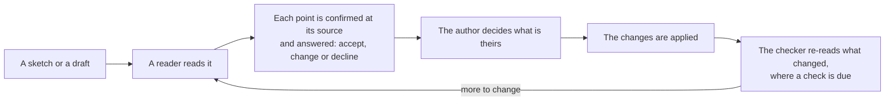

# ai-agent-science

Agent skills for a scientist who writes a journal paper with an AI agent and wants to be able to answer for every sentence in it. The toolkit is Markdown that tells the agent how to work, two small Python tools (one for the literature, one for checking sources) and one LaTeX package. It works in any agent harness that reads `SKILL.md` skills.

It works beside the science, which is often unfinished when the writing starts: what the paper cannot yet say becomes a list of questions for the scientist to act on. Its parts also work alone, outside any paper.

## The idea

A paper is verifiable when four things hold:

1. Every checkable sentence has its source beside it, reached in one step, or a visible gap where the source is missing.
2. A gap stops the paper building for submission.
3. Someone other than the writer has opened each source and compared it with the sentence, and the record says when and at which version of the text.
4. The author can audit a sample of sentences beside their sources in minutes, and see which text has changed since it was checked.

An agent writes fast and cannot see its own errors, and the author's attention is the scarce resource. So the toolkit makes the unverified visible, keeps what the author must read short, and never certifies anything itself. The author is the gate.

The mechanism is one comment beside each checkable sentence in the manuscript source (a *trace*), or a marker that prints loudly in a draft and fails the build in final mode (a *gap*):

```latex
% src: notes/run-log.md "converged after 200 iterations"
The fit converged after 200 iterations.

The residual is below the noise \gap{number}{command that would measure the residual}.
```

## What the scientist does

- **Says why the work was done**, what is settled and what is still open. The agent asks before it proposes anything.
- **Decides** the argument, which results the paper shows, the framing and the voice. The agent proposes and asks, each question with a recommendation.
- **Reads three things:** `paper/STATE.md` (what is true today and what the paper still needs), `paper/open-questions.md` and the PDF. Everything else the agent keeps is its own memory.
- **Audits** a random sample of sentences beside their sources before submitting.

The agent does the legwork: it reads the material, searches the literature, drafts from sources it has opened, and keeps the record. It does not run the analysis or produce results. Those come from the scientist, or from a separate investigation whose findings arrive with their records.

## The four skills

| Skill | What it does | Used alone? |
|---|---|---|
| `paper` | Writes a paper in its own workspace, from the first questions to the reply to the journal's referee. It calls the other three. | It makes its own workspace |
| `literature` | Answers five questions through ADS/SciX: has this been done; what is the closest prior work and what did it leave open; what supports or contradicts a claim; what values can be compared, and under which conventions; where a dataset or tool came from. Exports BibTeX from an authority, never composed. | Yes |
| `readers` | Four independent readers, each a brief for a fresh context that did not write what it reads. The checker asks whether each sentence says what its source says. The challenger asks whether a claim follows from its test. The referee asks what a journal would object to. The stylist asks whether the text communicates. | Yes, on any document, claim or result |
| `frame` | Turns an idea into a question that could be answered: the claim as one testable sentence, what it rests on and what is missing, what the literature says, two or three framings, and the test that would settle it. | Yes, with no workspace |

## How a paper is written with it

The `paper` skill is a map of what a scientist does, not a pipeline. The stages are not in order, none is a gate, and a paper returns to most of them many times.

| Stage | What happens | Where it is set out |
|---|---|---|
| Orient | The workspace is made, the material is read, the author is asked why the work was done and what is still open, and an argument is proposed for the author to correct | `skills/paper/start.md` |
| Position | The paper's place in the literature, its field's norms, its journal and, if wanted, a style sheet of the author's voice | the `literature` skill, `skills/paper/techniques/` |
| Evidence | Each claim is tested against what it rests on. A claim with nothing under it becomes a question for the scientist or an investigation. Results are read in as they arrive, and a result that changes comes back in through its claim. | `skills/paper/evidence.md` |
| Draft | A sketch to find the argument, or a section written from opened sources, with a trace or a gap beside each checkable sentence | `skills/paper/draft.md` |
| Verify | A fresh context re-opens every trace and compares it with its sentence | `skills/readers/checker.md` |
| Style and shape | How the paper reads, from the story it tells to the sound of each sentence | `skills/readers/stylist.md` |
| Referee | The paper is attacked as a journal's referee would attack it | `skills/readers/referee.md` |
| Finish | The checks before submission, the final build and the bundle the journal receives | `skills/paper/finish.md` |
| Respond | Co-authors and the journal's referee are answered through the same loop | `skills/paper/revise.md` |

**Effort follows how settled the text is.** Text is one of three things:

- a *sketch*: provisional and mostly gaps, written to find the argument or to show what is missing;
- a *draft*: written from opened sources and traced, but not yet read by anyone else;
- *checked*: an independent reader has re-opened every trace.

A check is due before anything rests on the text: a decision, another claim, a reader from outside, submission. Until then the author chooses. A paper whose shape is still moving is not polished and verified section by section only to be cut.

**All feedback goes through one loop**, whoever the reader is: an independent reader, the author with a red pen, a co-author or the journal's referee.



## Using one part alone

A reader, a literature question or a framing takes its inputs from whoever asks for it, in plain words. Three examples, as someone running an investigation might write them:

- **Frame an idea.** "Frame this with the frame skill: satellites in our model quench too early. The runs are in `results/` at commit `a1b2c3d`: read them, run nothing. Give me the claim as one sentence, what it rests on, what the literature has done, two framings and the test that would answer it. Reply here."
- **Challenge a claim.** "Use `skills/readers/challenger.md` on these two claims as worded: C1 ..., C2 .... Each rests on `findings/ledger.md` and `findings/receipts/` at commit `a1b2c3d`. Report to `reviews/challenge-1.md`, 600 words."
- **Referee a result.** "Use `skills/readers/referee.md` as the specialist for MNRAS on the result in `findings/result.md` at commit `a1b2c3d`, which states the comparison, methods, controls, evidence and limits. There is no venue or field file: say which judgements that left out. Return the report whole."

Each brief opens with what it must be given, and `skills/readers/SKILL.md` lists what any reader needs.

## What it runs on

**The core** (`skills/_shared/core.md`) is one page that every agent reads whole, in a paper or outside one. It holds seven rules: trace or gap; references are exported from an authority, never composed; the writer does not check itself; a claim is worded no stronger than its test; the author decides; read, do not run; shorter, and never by silent omission.

**The workspace** is the paper's own git repository, started from the scaffold in `skeleton/paper-workspace/`. Its `AGENTS.md` says what the paper may cite and at which version, and how commits are made. `skills/paper/workspace.md` says how a workspace works: the forms a trace and a gap take, the files the agent keeps, and how what the author says is recorded once they confirm it.

**The tools** use only the Python standard library.

- `tools/ads.py` searches ADS/SciX and writes BibTeX exactly as ADS returns it. It needs an [ADS/SciX API token](https://ui.adsabs.harvard.edu/user/settings/token).
- `tools/traces.py` reads the traces and gaps in a manuscript. Its `--help` is the full specification.

  | Command | What it reports |
  |---|---|
  | `list` | every trace and gap, with the gaps counted by kind |
  | `lint` | a trace that names nothing it can open, a path that may not be cited, an unknown citation key |
  | `quotes` | a quoted phrase it cannot find in the source its trace names |
  | `lost` | a trace that disappeared or moved in a change |
  | `stale` | a section changed since its last independent check |
  | `moved` | traces that point into files that changed in a source |
  | `sample` | traces drawn at random, for the author's audit |

- `skeleton/paper-workspace/manuscript/scipaper.sty` provides the gap.

## Scope and limits

- **LaTeX and git.** The trace is a LaTeX comment and the record is a git history. Word, Overleaf and reference managers are not supported.
- **Astronomy first for literature search.** `ads.py` searches ADS/SciX, which also holds arXiv and much of physics. A reference from anywhere else is exported by its DOI or arXiv id.
- **It does not make the science right.** A source beside a sentence gives somewhere to check, and an independent reader checks that the source supports it. Neither shows that the source is right. The readers are only as good as the models behind them, and the author's audit is the last check.
- **It is in development.** It has been used on two papers in progress, and no paper written with it has yet been submitted. Co-authors, submission and the reply to a journal are untried.

[`docs/VISION.md`](docs/VISION.md) sets out what the toolkit guarantees mechanically, what it leaves to judgement and what it does not claim.

## Installation

You need Python 3, git and `latexmk`. The procedures also call `curl` (to fetch references and full texts), `latexpand` and `latexdiff` (for the bundle sent to the journal and the reply to its referee) and Ghostscript (for EPS figures).

1. Clone this repository somewhere permanent. That directory is the *installation root*.
2. Link each of `skills/paper`, `skills/literature`, `skills/readers` and `skills/frame` into your harness's skills directory. `skills/_shared/` is read by the skills and is not linked.
3. Give `tools/ads.py` an ADS/SciX token: in the macOS Keychain under the service `nasa-ads-api-token`, in `$ADS_API_TOKEN`, or in `~/.ads/dev_key`.

To develop the toolkit, edit and commit in a separate clone and bring the installed copy forward with `git pull --ff-only`. Do not edit the installed copy. The tools' tests run from the repository root with `python3 -m unittest discover -s tools -p 'test_*.py'`.

## Starting a paper

Ask the agent to start one, for example: "Start a paper with the paper skill. The analysis is in this repository; two of the three results are final." It follows `skills/paper/start.md`: it copies the scaffold to a new directory, makes it a git repository, links the sources in, and asks why the work was done, what is still open and who the paper is for before it proposes anything.

Later sessions need no command. A session started in the workspace reads `paper/STATE.md` and picks up from there.

## Vision and backlog

Why the toolkit exists, who it serves, the commitments that define it and the principles that govern its design are in [`docs/VISION.md`](docs/VISION.md). What waits, and what was decided against, is in [`docs/BACKLOG.md`](docs/BACKLOG.md).

## Licence

MIT
