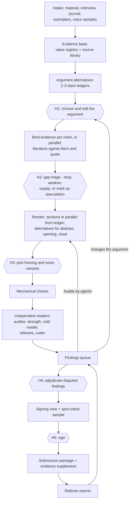

# Appendix B: clean-slate design, "agent-native, outcome-first" (requested on Fable 5.2; ran on Opus 5.5)

_Returned whole by the subagent (read-only; designed from the intent alone, then read VISION.md and README.md for section 9). The session asked for Fable 5.2 twice; the harness ran the agent on Opus 5.5 both times. Saved as received, 2026-11-27._

---

# Claim-first: an agent-native framework for papers a scientist can sign

The design below was written from the stated intent before I read the repository. Section 9, at the end, was added after reading `docs/VISION.md` and `README.md`. No files were created or changed.

## 1. Principles

1. **The argument is the source; prose is rendered from it.** The paper's core is a *claim ledger*: a small, explicit graph of claims, each tied to the evidence it rests on and worded at a stated strength. Prose comes from the ledger, not the other way round. This is the main agent-native move. Models are strong at turning structure into prose and weak at keeping a long draft honest. So most checking happens on the structure, where it is cheap, and the prose check becomes a narrower question: does this sentence faithfully render claim C7?
2. **Responsibility comes from decisions, not keystrokes.** The scientist signs because they made each consequential decision and checked a sample of the evidence themselves, not because they read every word as a proofreader. The toolkit's job is to put those decisions on the surface and make each one cheap.
3. **Models never type facts.** Numbers come from a value registry filled by scripts from the scientist's outputs, and the manuscript refers to them by key. References come from an authority (DOI, arXiv, a literature database), and a statement about another paper is tied to a quoted passage in a fetched copy. A model may choose which fact to use. It may not compose the fact.
4. **Each checkable sentence has an anchor or a visible gap.** Nothing is in between. An unanchored checkable sentence is a defect that gets detected, not a style choice.
5. **The writer is never the checker.** Independence is designed in: readers get a separate context, are blind to the writer's reasons, use a different model provider where one is available, and are given adversarial goals. Their recall is measured with planted faults, not assumed.
6. **Deterministic tools where failure is silent; model judgement where meaning matters.** Use a small tool for anything a script can decide, and a reader for anything that needs understanding. Never ask a model to do what a script can.
7. **The scientist's attention is the budget.** Every human decision arrives as a short card with options, a recommended default and the evidence. Decisions are batched, and the scientist is never asked for what an agent or a script could settle.
8. **Less by default, never by silent omission.** Every claim and section has a length budget. Cutting is its own role. A cut that drops a sourced fact says so.
9. **Field norms come from examples, not rules.** The scientist picks 3–5 exemplar papers from the target journal and subfield. Agents derive a norms sheet from them (structure, hedging, citation density, what goes unsaid), and the readers use the same sheet.
10. **It writes up work; it does not do the work.** If an argument needs a result that does not exist yet, it becomes a request to the scientist, never an analysis the agent runs and reports.
11. **Prescribe outcomes and gates, not steps.** Instructions say what must be true and who decides, and agents are trusted to get there. The toolkit stays small enough to read in one sitting.

## 2. The process

The process is three nested loops around one source of truth, not a linear pipeline. The **argument loop** sets what the paper claims. The **render loop** turns claims into prose. The **verification loop** runs until the findings queue holds only things the scientist must judge. A change at any level marks what depends on it as stale (mechanically, through anchors), and only stale parts are re-rendered and re-checked.



**Human decision points** (all of them; nothing else needs the scientist):

| Gate | Decision | Form that keeps it cheap |
|---|---|---|
| H0 Intake | Why the work was done, for whom, which journal, exemplars, voice samples | A 20-minute interview the agent leads; the answers are written into the brief for the scientist to confirm |
| H1 Argument | Which story, which main claim, which results go in or stay out | Two or three ledgers side by side on one page each, with a recommendation and what each one leaves out |
| H2 Gap triage | What to do with claims that have no evidence | One card per gap: drop / weaken (proposed wording shown) / supply (what is needed) / keep as stated speculation |
| H3 Framing and voice | Abstract, opening paragraph, conclusion, title | Three variants each, differences highlighted; pick or merge |
| H4 Adjudication | Findings the agents could not settle or that touch the science | Cards with the sentence, the evidence, the reader's objection, the proposed fix |
| H5 Sign-off | "I can answer for this" | Signing view (§3) plus a random spot-check of ~10 anchors done personally |

## 3. Artefacts

All of them are plain text in a git repository per paper. Each has one purpose and one owner.

| Artefact | Purpose | Written by | Format |
|---|---|---|---|
| `brief.md` | Intent: why, contribution in one sentence, audience, journal, what the paper must not claim | Agent from interview; scientist confirms | Markdown |
| `values.yaml` | Every number the paper may state: key, value, uncertainty, unit, source file, extraction command, content hash | Script, from the scientist's outputs; agents propose entries, the script fills the values | YAML |
| `sources/` | One record per cited work: authority metadata, fetched text at a recorded version, quoted passages with locations | Literature agents through the citation tool | BibTeX exported verbatim + one Markdown note per source |
| `argument.md` (the ledger) | Claims with ids, type (result, comparison, prior work, method, interpretation, limitation), wording at a stated strength, evidence links, dependencies, length budget, status | Agents propose; the scientist owns | Markdown with a small fixed header per claim |
| `norms.md` | Field and journal norms taken from the exemplars and the journal's instructions | Agent; scientist skims | Markdown |
| `voice.md` | The scientist's voice: distilled features, preferred and banned phrasings, worked before/after examples | Agent from samples; corrected by the scientist's edits over time | Markdown |
| `paper/` | The manuscript. Each checkable sentence carries `\c{C7}` (claim anchor), numbers are `\v{key}`, citations `\cite{}` only to keys in `sources/`, and missing evidence is `\gap{kind}{what would close it}` | Render agents | LaTeX (or Markdown/Pandoc/Typst) |
| `findings.jsonl` | Every reader finding: reader, model, target, severity, status, resolution | Readers append; the conductor resolves | JSON lines |
| `decisions.md` | Every human decision with date and options considered: the accountability record and the source of the AI-use declaration | Conductor records; scientist confirms | Markdown, append-only |
| Signing view (generated) | The paper with each sentence coloured by anchor status and check status, open gaps, residual disputes, claims whose strength was challenged | Tool | HTML or PDF |

The key artefact is the ledger. Its value is that the argument can be checked without any prose: does the main claim follow from its supports, is each comparison like for like, is any claim stronger than its evidence. At that level the scientist can read the whole paper in five minutes.

## 4. Checks

### Mechanical (deterministic, run on every build, cheap enough to run constantly)

- **Anchor integrity:** every `\c{}`, `\v{}` and `\cite{}` resolves; no claim in the ledger is orphaned; no anchor points to a claim the ledger has dropped.
- **Value freshness:** each value's source hash still matches; a changed result file marks the value, its claims and their sentences as stale.
- **No typed numbers:** a number in prose outside `\v{}` (beyond a whitelist: section numbers, small integers in counting words) is flagged.
- **Citation authority:** each key has an authority record; DOI and arXiv metadata match; no key was composed.
- **Quote presence:** each quoted passage behind a prior-work claim appears verbatim in the fetched source at its recorded version.
- **Staleness propagation:** a change to a claim, a value or a source marks the dependent sentences unchecked.
- **Checkable-sentence detector:** a cheap heuristic (digits, comparatives, "first", "previous", "consistent with", named methods and datasets, citations) plus a small-model classifier lists sentences that look checkable but have no anchor or gap. It errs towards recall.
- **Budgets and journal compliance:** word, figure and reference limits, required sections, abstract length.
- **Gap gate:** in final mode, any open `\gap` fails the build.

### Judgement (model readers, each a fresh context with a narrow brief)

| Reader | Sees | Question |
|---|---|---|
| **Anchor auditor** | One sentence + its evidence only (not the paper, not the writer's notes) | Does the evidence say this, no more and no less? |
| **Strength auditor** | Claim wording + its test or evidence | Is the claim as strong as the test allows? (overreach, missing caveats, wrong hedge) |
| **Cold reader** | The rendered paper only | Reconstruct the main claim, the supports and the limitations. The tool diffs this against the ledger; a mismatch is a clarity failure that no fact check catches |
| **Referee panel** | Paper + `norms.md` + journal referee guidance | Would this be accepted? One context per angle (method, novelty and positioning, presentation) |
| **Cutter** | Paper + budgets | What can go without losing a claim? Proposes deletions as a list, never silently |
| **Voice reader** | Paper + `voice.md` | Where does it not sound like the author, or sound like a model? |

### How independence is achieved, cheapest first

1. **Context separation.** A reader never sees the writer's reasoning, only the artefact and the evidence. This removes most self-agreement.
2. **Narrow inputs.** The anchor auditor sees one sentence and one source, not a persuasive whole.
3. **Provider diversity.** At least the anchor auditor and one referee run on a different provider from the writer when the harness allows. Errors are correlated within a model family.
4. **Adversarial framing.** Readers are told the text contains errors and are judged on confirmed findings.
5. **Sampling.** Run the auditor k=2–3 times at temperature and take the union of findings (recall is the aim), then confirm each finding at source before acting (precision).
6. **Canaries.** Before a milestone, the tool plants a few known faults in a scratch copy (a changed value, an overstated claim, a misattributed citation) and checks that the readers catch them. Reader recall becomes a measured number, shown in the signing view, instead of an article of faith.
7. **The human sample.** The scientist personally checks ~10 anchors drawn at random, weighted towards claims central to the argument. That is the last check and the one that earns the signature.

A finding is a lead, not a verdict. The conductor confirms it at source before changing anything, and anything touching the science goes to H4.

## 5. Roles

- **Scientist (orchestrator).** Owns the brief, the ledger, framing, voice and every gate. Does not proofread. Audits by sampling and decides.
- **Conductor (the main agent session).** Keeps the ledger and the findings queue, dispatches work, confirms findings at source, prepares decision cards, records decisions. It never decides the science.
- **Extractors (subagents, parallel).** Evidence extractor: proposes registry entries from the scientist's outputs. Literature agent: searches, fetches, quotes, exports authority records. Neither writes prose.
- **Renderers (subagents, parallel by section).** Turn ledger claims into prose under `norms.md` and `voice.md`, within budget, anchoring as they write. They produce alternatives where a gate asks for them.
- **Readers (fresh contexts, mixed providers).** As in §4. Each has a one-page brief and never edits the paper; they only write findings.

That is one human and four agent roles. Personas within a role are prompt parameters, not new roles.

## 6. Packaging

```
claim-first/
├── AGENTS.md                # the one file every session reads: principles, gates, artefacts, the loop (≤2 pages)
├── instructions/            # outcomes and briefs, read when the case arises
│   ├── conductor.md         # intake interview, ledger upkeep, decision cards, findings triage
│   ├── extract-evidence.md
│   ├── literature.md        # authority adapters: Crossref/DOI, arXiv, PubMed, ADS, Semantic Scholar
│   ├── render.md            # from ledger to prose; alternatives; anchoring
│   ├── respond.md           # referee reports → findings → response letter
│   └── readers/             # one brief each: auditor, strength, cold-reader, referee, cutter, voice
├── tools/                   # one small CLI, standard library only, with tests
│   └── cf.py                # check | values | cite | stale | detect | canary | sample | signview | declare | bundle
├── templates/workspace/     # copied per paper
│   ├── AGENTS.md            # paper-specific pointers (install root, journal, providers available)
│   ├── brief.md  argument.md  norms.md  voice.md  values.yaml  decisions.md
│   ├── sources/             # bib + notes
│   ├── paper/  claimfirst.sty   # \c \v \gap macros; draft mode shows status colours
│   └── findings.jsonl
├── examples/mini-paper/     # a worked, field-neutral example with seeded faults
└── docs/                    # vision, design rationale, backlog
```

**Instructions vs tools vs templates.** Instructions say *what must be true and who decides*. Tools enforce what a script can decide (resolution, freshness, authority, staleness, canaries, sampling, rendering the signing view). Templates fix the artefact shapes so tools can parse them. Harness-specific wiring (skills, slash commands, subagent definitions) is a thin adapter layer generated from `instructions/`, so the toolkit works with any harness that can read Markdown and run Python.

## 7. The scientist's experience

**Day 1 (about an hour).** The scientist points the agent at a folder: result files, figures, notebooks, notes, slides, a half-written paragraph. They answer an interview of about 20 minutes: why this work, what is new, who must believe it, which journal, which three papers they admire in that journal, and two of their own papers for voice. While they get coffee, extractors fill the registry, the literature agent builds a first source library, and the conductor drafts two or three argument ledgers. They return to a one-page comparison, for example: "A leads with the method, B with the astrophysical result, C with the tension against prior work; B drops your third result. Recommended: B." They pick, edit two claims, and strike one. The ledger is now theirs. Gap cards are already waiting (e.g. "C5 says *faster than previous methods*, but no timing comparison is in your outputs: drop / weaken to *competitive* / supply a timing run").

**Mid-paper (one or two sessions of 30–45 minutes a week).** Renderers draft every section in parallel overnight. The verification loop runs until the findings queue holds only what agents cannot settle. The scientist opens a batch of 5–15 decision cards: three abstract variants, a referee's novelty objection with the proposed reframing, a strength challenge on the central claim, a cutter proposal removing 600 words. Each card takes about a minute. They read the paper once in draft mode, where colour shows anchored, gapped and unchecked text, and they edit prose directly when they want to. The conductor reads their edits as voice signal and updates `voice.md`. Direct edits to checkable sentences are re-anchored and re-audited like any other change.

**At submission (about an hour).** The signing view shows zero open gaps, the canary recall of the readers ("auditor caught 9 of 10 planted faults; the missed one was a hedging change"), residual disputed findings with their dispositions, and the claims whose strength was challenged and how each was resolved. The scientist does the random spot-check: ten sentences, each next to its evidence, a click to the source. They sign. The tool generates the bundle, the AI-use declaration (from `decisions.md`, specific about what agents did and what the scientist decided), and an optional **evidence supplement** for editors and referees: the claim ledger with links to evidence, and the list of checks run and their results. The declaration becomes evidence rather than an assertion. When reports come back, each referee point becomes a finding tied to claim ids, goes through the same loop, and the response letter is assembled from the dispositions with diffs.

## 8. Risks and weaknesses

- **The ledger may not fit every genre.** It suits empirical papers. Reviews, theory papers, essays and humanities work have arguments that resist claim-by-claim breakdown. *Mitigation:* the ledger can be coarse (one claim per paragraph), and for discursive sections anchoring falls back to sentence-level traces. Still a real limit.
- **Prose compiled from structure can read as stitched.** *Mitigation:* render whole sections, not single claims; run the voice reader and cold reader; let the scientist edit freely. Some quality loss against a great human writer is likely.
- **Anchored is not true.** An anchor shows where to check, not that the sentence is right. Entailment judgement stays fallible, and the evidence itself can be wrong. The design makes errors findable; it does not make them impossible.
- **Correlated model errors.** Provider diversity and canaries reduce this but cannot remove it. Canaries measure only the fault kinds we think to plant.
- **Rubber-stamping.** Cheap decision cards invite approval without thought. *Mitigation:* cards show what each option drops; the spot-check is random and personal; `decisions.md` records time spent per card, so a 3-second H1 is visible to the scientist. Ultimately this rests on the scientist's integrity.
- **Gaming the detector.** Agents may write vaguer sentences to avoid being "checkable". *Mitigation:* the strength and referee readers flag vagueness, and the cutter removes empty sentences. This needs watching.
- **Overhead on small papers.** A four-page letter does not need five readers. *Mitigation:* readers scale with the paper, and mechanical checks are always on.
- **Access and confidentiality.** Paywalls limit quote verification, and unpublished data passes through model providers. The scientist decides, and the tool records which sources could not be fetched.
- **Over-engineering.** The tool list in §6 is already near the limit. Each subcommand must justify itself by a failure that would otherwise be silent.

## 9. Mapping onto the existing repository

Reading `docs/VISION.md` and `README.md` shows that the existing toolkit already embodies most of this design's principles. Its eight commitments cover trace-or-gap, authority-sourced references, the writer not checking itself, strength checked separately, the author deciding, no results produced by writing, shorter without silent omission, and a record of who did what. They line up closely with principles 2–5, 8 and 10. The real differences are in where the structure lives, how numbers enter the text, how human decisions are packaged, and how reader quality is measured.

| Existing | In this design | Action |
|---|---|---|
| Eight commitments (`VISION.md`, `core.md`) | Principles 2–5, 8, 10 | **Keep** as they are |
| `% src:` trace comment + `\gap` (`scipaper.sty`) | Anchor or gap | **Keep**. Add a claim-id form (`% claim: C7`) alongside the source trace instead of replacing it |
| `paper/outline.md` (argument, budgets) + claims file | `argument.md` ledger | **Merge** into one ledger with claim ids, strength wording, evidence links and dependencies. "One place for each truth" argues for this |
| `traces.py` (`list`, `lost`, `lint`, `stale`, `moved`, `sample`) | `cf.py` check/stale/sample | **Keep and extend**: value-registry resolution, quote-presence check against the pinned source (if `lint` does not already do this), claim-level staleness, canary |
| `ads.py` + `literature` skill (ADS/SciX only) | Literature with authority adapters | **Generalise**: add Crossref/DOI, arXiv, PubMed. ADS-only conflicts with "any field" |
| Readers: checker, challenger, stylist, referee | Auditor, strength, voice/cutter, referee | **Keep and rename lightly**. **Add** the cold reader. Split cutting out of the stylist only if use shows it is needed |
| `revise` loop (numbered points, disposition) | Findings queue | **Keep the loop**. Store findings in a machine-readable file so the signing view and declaration can be generated |
| Decision journal, `STATE.md` | `decisions.md` | **Keep**. Add a decision-card format for the questions the agent asks |
| Stages as a map, not a pipeline | Three loops | **Keep the map framing**. Add explicit parallel rendering and argument alternatives at orient |
| `techniques/field.md`, `venue.md`, `style-sheet.md` | `norms.md` from exemplars, `voice.md` | **Keep**. Make the exemplar papers an explicit intake input |
| `finish.md` (final build, bundle) | Signing view + supplement + declaration | **Add** a generated signing view and declaration to finish |
| No value registry; numbers typed and traced | `values.yaml` + `\v{}` | **Add** (see recommendation 1) |
| Nothing drops outright | — | The existing set is already lean |

### Ideas I would most urge the owner to adopt

1. **Numbers come from a value registry, never typed.** Prose refers to `\v{key}`; a script fills each value from the scientist's outputs and records a content hash. *Benefit:* it removes the most common and most damaging agent error (invented or drifted numbers) by construction, and makes changed results propagate automatically. It fits "a tool only where failure is silent". *Confidence:* high. *Complexity:* medium (registry format, extraction helpers, a LaTeX macro, staleness hook).
2. **Measure reader recall with planted faults (canaries).** *Benefit:* turns "an independent reader checked it" into a number the scientist and editor can see, and shows which fault types the readers miss. *Confidence:* medium (measures only what is planted). *Complexity:* low (scratch copy, a handful of mutations, compare findings).
3. **A cold-reader reconstruction test.** A fresh context reads only the paper and states its argument; the result is diffed against the ledger. *Benefit:* catches the failure no trace check can, a paper whose argument does not come across. *Confidence:* medium-high. *Complexity:* low (one brief plus a comparison step).
4. **Decision cards and batched gates.** Every question to the author comes as options, a default, and what each option drops. *Benefit:* the largest saving of the scientist's attention, and a cleaner `decisions.md` for the declaration. *Confidence:* medium (rubber-stamping risk). *Complexity:* low (a convention in the conductor instructions).
5. **Merge outline and claims into one ledger with claim ids, and anchor sentences to claims.** *Benefit:* lets the argument be checked without prose, gives claim-level staleness, and maps referee points to claims. *Confidence:* medium (may feel rigid for discursive papers; keep it coarse). *Complexity:* medium.
6. **Alternatives at the high-leverage points.** Two or three argument ledgers at orient, and three variants of abstract, opening and title. *Benefit:* choosing is cheaper and better than correcting a single proposal, and keeps framing with the scientist. *Confidence:* medium. *Complexity:* low.
7. **Generalise the literature authority beyond ADS.** *Benefit:* required by the stated generality goal; today non-astronomers have no authority path. *Confidence:* high. *Complexity:* medium (adapter per authority, verbatim export each).
8. **A different provider by default for the anchor auditor at milestones**, recorded in the findings. *Benefit:* fewer errors shared between writer and reader. *Confidence:* medium. *Complexity:* low to medium (depends on the harness).
9. **A generated signing view and evidence supplement for editors.** *Benefit:* makes the vision's "evidence, not a bare declaration" concrete and cheap to produce. *Confidence:* medium (editor uptake unknown). *Complexity:* low to medium (built from existing trace output and findings).

My recommended order is 1, 7, 3, 2, 4, then the rest as use shows the need, consistent with the repository's own "grow only where use shows a gap" principle.
