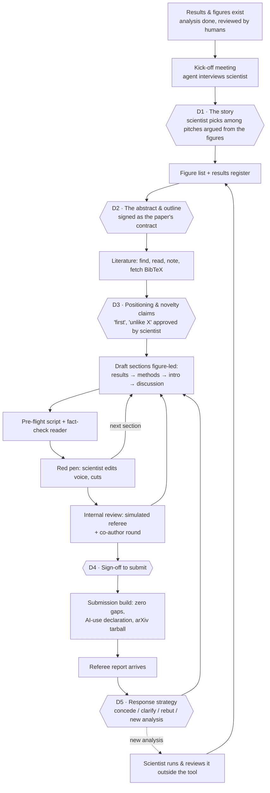

# Appendix C: clean-slate design, "how scientists actually write papers" (Opus 5.5)

_Returned whole by the subagent (read-only; designed from the intent alone, then read VISION.md and README.md for section 9). Saved as received, 2026-11-27._

---

# Countersign: a design for writing peer-reviewed papers with AI agents

*Written from the intent alone. The final section maps the existing repo onto it and was written only after reading `docs/VISION.md` and `README.md`. No files were created or edited.*

## 1. Principles

1. **Write up results that already exist.** Most papers start from figures and numbers that already exist. The toolkit writes them up and never produces a result. If a needed number or figure is missing, that is a gap for the scientist to fill. The agent does not fill it.
2. **The scientist signs decisions, not keystrokes.** Responsibility comes from a small number of named decisions that a PI would recognise: the story, the figure set, the abstract, the key claims of novelty, submission, and the response strategy. Each one is recorded in the scientist's own words.
3. **Every checkable sentence has a source, or a visible gap.** Numbers come from a results file, citations from a reading note that quotes the paper, and comparisons from both. A sentence with no source carries a gap marker that shows in red in drafts and stops the final build. A draft can be incomplete. It can never look complete when it is not.
4. **Numbers are generated, not typed.** Many groups already write `\newcommand{\Nsample}{1{,}204}` macros from their analysis code. The toolkit makes that the only route for a number to enter the text. This closes off the most dangerous kind of agent error at its source.
5. **The writer never checks its own work.** Checks are done by readers who have a fresh context, cannot see how the text was drafted, cannot edit the manuscript, and write a report. The writer has to answer every point, as in a referee response.
6. **The field's norms come from examples, not from the model's defaults.** The scientist names three to five papers the paper should "read like" (often their own) and the target journal. Voice, length, section conventions and how much hedging is normal are all calibrated against those papers.
7. **Cutting is a first-class operation.** Agents pad. The supervisor's red pen is a stage of its own, with word budgets set from the example papers. A cut may drop a sourced fact only if the cut says so.
8. **Use the technology people already have.** The paper stays in whatever the group uses (LaTeX/Overleaf through git sync, or Markdown/Quarto). git history is the notebook of the manuscript. Tools are a few small scripts.
9. **Give the agent instructions, and write code only where failure is silent.** Judgement lives in short prose instructions. A script exists only where agents demonstrably fail and nobody would notice: numbers, references, gaps and limits.

## 2. The process, mapped to the paper lifecycle



The diagram looks linear, but in practice the loop from drafting to the red pen runs many times, and new figures often appear during the co-author round. Every arrow can be revisited. The hexagons are the only points where the tool waits for the human. Everything else the agent may do on its own and report back.

The order of drafting follows real practice and is deliberate. The results come first, because they are fixed. Methods follow, because they are mechanical. The introduction and discussion come after, because they depend on what the results turned out to say. The abstract is drafted early as a contract and rewritten last.

## 3. The artefacts, in scientists' vocabulary

| Artefact | What scientists call it | Purpose | Who owns it |
|---|---|---|---|
| `brief.md` | the pitch / "what's the paper?" | One page: the question, the answer, the one figure you'd show on a single slide, the audience, the journal, the papers it should read like | Scientist (the agent drafts it from the interview; the scientist rewrites it) |
| `figures.md` + `figures/` | the figure list | The paper's backbone. Each figure has a caption draft, the one sentence it supports, and the section it belongs to (and an owner in big collaborations) | Scientist decides; agent maintains |
| `results.yaml` | the numbers file / lab-book extract | Every quantity the paper may quote: value, uncertainty, units, and where it came from (script and commit, table, or "M. Lee, email 3 Mar"). Generates the number macros | Ideally written by the analysis code; otherwise confirmed by the scientist |
| `refs.bib` + `reading/` | the bibliography and reading notes | One note for each cited paper: what we say it says, with a verbatim quote and its location. BibTeX is fetched from an authority (DOI, Crossref, arXiv, ADS, PubMed), never typed by the agent | Agent; the scientist approves the key ones (D3) |
| `outline.md` | the skeleton | Section roles, paragraph plans, word budgets, and the contract abstract | Scientist approves (D2) |
| `paper/` | the manuscript | LaTeX or Markdown with source tags and gap markers | Shared |
| `log.md` | the paper notebook | Dated decisions in the scientist's words, what was asked of the agent, what was cut and why | Agent records; scientist's words quoted |
| `reviews/` | reports | Fact-check reports, internal referee reports, the co-author comment table, journal referee reports, each with a response to every point | Readers write; writer responds; scientist decides |
| `declaration.md` | the AI-use statement | Generated from the log: what was drafted by agents, what was checked and how, what the humans decided | Scientist signs |

**Source tags.** These follow existing habits. In LaTeX, `\num{sfr_median}` pulls a value from the register, `\cite{}` stays as it is, `% src: reading/smith24.md "quoted text"` marks a claim about another paper or a comparison, and `\gap{kind}{what would close it}` marks a hole. A small `.sty` file prints gaps in red with a margin note in draft mode and raises an error in final mode, so co-authors on Overleaf see the holes without installing anything. Markdown uses the equivalents: `{{num:key}}`, `[@key]`, `<!-- src: -->` and `[GAP: …]`.

## 4. The checks and how independence is obtained

**Mechanical checks (scripts, deterministic, run by `check`, which prints a one-page "pre-flight" report):**
- Bare numbers. Any digit in prose that did not come through a macro, apart from an allow-list (years, section numbers, equation constants), is listed.
- Stale numbers. A register entry whose source file has changed since the value was recorded is flagged.
- References. Every `\cite` key resolves. Every bib entry has a DOI, bibcode or arXiv ID that resolves, and was fetched rather than composed. Every cited claim has a reading note.
- Gaps. They are counted and listed by kind. Final mode fails if any remain.
- Journal limits. Word, abstract, figure and reference counts are checked, plus required sections (data availability, code availability, AI statement).
- Lost sources. A diff between versions lists source tags removed by an edit, so a cut cannot silently drop evidence.

**Judgement checks (independent readers, each given a short brief):**
- **Fact-checker** (the careful co-author who re-derives everything). For each tagged sentence it opens the source and asks whether the sentence says what the source says, with the same sign, direction, scope and hedging. It also flags sentences that make a checkable claim with no tag.
- **Claim-strength reader** (the sceptical colleague). It asks whether "significant", "first", "demonstrates" and "rules out" follow from the test actually done. Correct citations can sit under an overstated claim, and source-checking alone will not catch it.
- **Internal referee.** It reads the compiled PDF, the journal's referee guidelines and the brief's example papers, and nothing else. It writes a referee report.
- **Red-pen editor.** It reads against the example papers for length, voice and field conventions, and proposes cuts and rewrites. The scientist's own red pen always overrides it.

**How independence is obtained, cheaply:**
1. A fresh context with no drafting history, only the artefacts a real reader would have.
2. Readers write reports and never edit the manuscript.
3. A different model or harness at milestones (before the co-author round and before submission) where one is available, because errors from the same model are correlated.
4. The writer's response to each point (accept, accept with a different fix, or decline with reason) is recorded, and the scientist sees the declines.
5. **Spot audit.** The `sample` command shows the scientist ten random tagged sentences side by side with their sources. This takes five minutes, and it is the scientist's own evidence that the readers can be trusted.

## 5. The roles

| In a research group | In Countersign | Notes |
|---|---|---|
| PI / lead author | **Scientist (orchestrator)** | Owns the brief, the story, the decisions, the voice and the signature |
| Student/postdoc who drafts | **Writer agent** | Drafts, does the literature legwork, maintains the artefacts and responds to reports |
| Librarian / the group's literature expert | Writer in "literature" mode | Finds, reads, notes and fetches. Does not need to be a separate persona |
| Careful co-author | **Fact-checker reader** | |
| Sceptical colleague at group meeting | **Claim-strength reader** | |
| Friendly internal reviewer | **Internal referee reader** | |
| Supervisor's red pen | **Editor reader**, then the scientist | |
| Co-authors | Humans | Comments come in from Overleaf, PDF annotations or email; the agent collates them into a numbered comment table |
| Collaboration publication board | Humans at D4 | The pre-flight report and reader reports are their review package |
| Journal referee | External | The response uses the same loop as any reader |

**Where following human practice pays off.** Figure-first, the referee, the co-author round, the lab notebook and the red pen are mental models everyone already holds. A fact-check report is trusted the way a referee report is. Fitting Overleaf, arXiv and journal templates is a precondition for adoption by co-authors who will never install anything.

**Where it does not.** A simulated hierarchy (a "postdoc agent" reporting to a "PI agent") is theatre: two roles, writer and reader, carry the substance. Human latency cycles (a draft goes to the supervisor for two weeks) should not be copied. The everyday human habit of copying numbers from slides and citing from memory is exactly what this toolkit breaks with on purpose. The student's learning-by-writing has no analogue here, because the agent does not learn and the log is the memory. "Write the introduction first" is common advice that agents should not follow.

**Single authors versus collaborations.** For a single author, the readers stand in for the co-authors they don't have, which is the biggest gain. In a large collaboration, the register is owned by the analysis team, sections carry owners in `figures.md`, and D4 is the publication board.

## 6. Packaging as a toolkit repo

```
countersign/
  README.md              one page: the idea, the five decisions, quick start
  AGENTS.md              the entry point any harness reads: the core rules (≤2 pages)
  stages/                one short instruction per stage, read when needed
    kickoff.md  story.md  literature.md  drafting.md  red-pen.md
    co-authors.md  submission.md  referees.md
  readers/               briefs for independent readers
    fact-checker.md  claim-strength.md  referee.md  editor.md
  tools/                 Python stdlib only; each does one thing
    check                umbrella: pre-flight report
    numbers.py           register → macros; bare-number scan; staleness
    refs.py              fetch BibTeX from DOI/Crossref/arXiv/ADS/PubMed; resolve; note coverage
    gaps.py  limits.py   gap listing; journal limits
    sample.py            random spot audit
    declare.py           AI-use statement from the log
  templates/
    workspace/           brief.md figures.md results.yaml log.md outline.md reviews/
    latex/countersign.sty   \num \gap, draft vs final mode
    markdown/            Quarto/Pandoc filter equivalent
  fields/                optional, contributed, one page each: norms, reporting
                         checklists (CONSORT, STROBE, PRISMA), citation habits
  examples/              one small worked paper with its full record
```

The split is simple. **Instructions** hold judgement (how to argue, what to leave out, how to answer a referee). **Tools** hold only the silent failures. **Templates** hold the shapes of the artefacts. `init` copies the workspace template into a new git repository, or into an existing Overleaf-synced repository, and adds a two-line `AGENTS.md` pointing back to the toolkit. Fields beyond astronomy plug in through three things: the reference authority (PubMed, Crossref), a reporting checklist that becomes a reader's brief, and, for theory papers, sources that point to derivations in an appendix or notebook rather than to data.

## 7. The scientist's experience

**Day 1.** The scientist runs `init` and points the agent at the figures directory, the analysis outputs and a few notes. The agent holds a ten-minute **kick-off meeting** with five questions: what did you find; if you had one slide, which figure; who must read this; which journal; which three papers should it read like? It drafts `results.yaml` from the outputs, and the scientist confirms or corrects the values. Better still, the scientist adds three lines to their analysis script so it writes the register itself. The agent then proposes two or three **pitches**, each a different story argued from the same figures: what leads, what is supporting, and what gets dropped. The scientist picks one and rewrites the brief in their own voice (D1). By the end of the day there is a brief, a figure list, a register and a contract abstract (D2). No prose has been written yet, and that is the point.

**Mid-paper.** The agent drafts the results section from the figures, then the methods. Each section goes through `check` and the fact-checker before the scientist sees it. The scientist reads a PDF with red gaps and margin source tags, and red-pens it in the source, as Overleaf comments, or by dictation. The agent applies the edits and logs the decisions. The literature pass produces reading notes, and the scientist approves the handful of novelty and comparison claims (D3). Before the co-author round the internal referee reads the whole paper. The co-authors receive a normal PDF and a short "state of the paper" note: open gaps, the latest fact-check summary, and the points that are still undecided. Their comments come back as a numbered table, with every comment answered.

**At submission.** `check --final`: zero gaps, every number generated and current, every reference resolved and noted, limits met. A second model reads the whole paper as referee. The scientist does a spot audit of ten sources and signs off in the log (D4). `declare` drafts the AI-use statement from the log. It is factual and specific, and the scientist edits and signs it. The build produces the journal bundle and the arXiv tarball.

**Referee response.** The scientist pastes in the report. The agent splits it into numbered points and drafts a response table with a proposed action for each point: concede, clarify, rebut with evidence, or *new analysis needed*. That last kind goes to the scientist and is never run by the writer. The scientist decides the strategy (D5) and writes or approves the tone. The agent makes the changes, `check` and the fact-checker re-read only what changed, `latexdiff` produces the marked-up version, and the response letter quotes the revised text.

## 8. Main risks and weaknesses

- **Rubber-stamping.** The decision points can become clicks. The defence is that decisions are recorded in the scientist's own words and kept few. This is cultural rather than technical, and it will sometimes fail.
- **A source tag checks form, not substance.** A sentence can point at a source that does not support it. The fact-checker is an LLM and can miss this, especially when it shares a model with the writer. The spot audit is the real backstop, and it only samples.
- **Provenance can be nominal.** If the scientist pastes numbers into the register by hand, it only records that the scientist said so. It is stronger when the analysis code writes it, and that requires a small change to how the scientist works.
- **The bare-number scanner will be noisy** across fields (units, years, equations, gene names). Too many false positives and people stop running it.
- **Full-text access.** Reading notes need full texts, which paywalls block. Without the text there should be a gap, but agents may quietly fall back to the abstract.
- **Voice drift and pastiche.** Calibrating against example papers can produce imitation, not the scientist's own voice.
- **Collaborators outside git.** Word-only co-authors and Overleaf users without sync add friction at the co-author round.
- **Over-engineering creep.** Every failure invites a new script. The rule "code only where failure is silent" has to be defended actively.
- **Declaration honesty.** A generated declaration can overstate human involvement if the log is thin.
- **Theory and qualitative fields** fit the number register poorly. Their "evidence" is argument, and only the claim-strength reader really helps there.

---

## 9. Mapping onto the existing repo (after reading VISION.md and README.md)

The existing toolkit is already very close to this design in substance. "Trace or gap", references from an authority, the writer not checking itself, claim strength read separately, the author deciding, writing not producing results, shorter without silent omission, and the record showing who did what correspond one-for-one to my principles 1, 3, 5 and 7 and to my readers. The differences are mostly in **where the paper starts** (figures and numbers versus an argument), **how numbers enter the text**, **vocabulary**, and **generality beyond astronomy and SKILL.md harnesses**.

| Existing | In this design | Verdict |
|---|---|---|
| `% src:` trace + `\gap` + final-mode failure (`scipaper.sty`) | Source tags + gap markers + `countersign.sty` | **Keep** as is |
| `traces.py` `list/lint/lost/stale/moved` | Parts of `check` (gaps, lost sources, staleness) | **Keep**; give the user-facing name "pre-flight" |
| `traces.py sample` | `sample.py` spot audit | **Keep**. I adopted it in §4, because it is the cheapest way for the scientist to earn trust in the readers |
| `ads.py` | `refs.py` with several authorities | **Generalise**: ADS becomes one back-end among DOI/Crossref/arXiv/PubMed. VISION already promises "a literature database, arXiv or a DOI" |
| readers: checker, challenger, stylist, referee | fact-checker, claim-strength, editor, referee | **Keep**. The challenger is the claim-strength reader. Consider user-facing names scientists use ("fact-check", "red pen") |
| Stages orient/position/evidence/draft/verify/style/referee/finish/respond | kickoff/story/literature/drafting/red-pen/co-authors/submission/referees | **Merge and rename** toward lifecycle vocabulary. Orient becomes kick-off plus story. Verify and referee become reader briefs, not stages. Respond covers co-authors and referees |
| Single `revise` loop for all feedback | Same: every reader writes a report, every point gets a disposition | **Keep**. It is the best idea in the repo |
| `paper/outline.md` (intent, narrative, argument, budgets) | `brief.md` + `outline.md` | **Split**. Give the one-page brief its own artefact, signed by the scientist |
| `paper/style.md` (voice from past papers) | Example papers in the brief | **Keep**, and let the example papers include papers by others in the target journal |
| Decision journal, STATE.md, claims, open questions | `log.md` (+ gaps in the manuscript) | **Probably merge** toward fewer files. I could not see their contents, so this is low confidence |
| Evidence stage with "investigations" | No equivalent; new analysis goes back to the scientist | **Watch it**: it sits close to the "not an AI scientist" boundary |
| `AGENTS.md` sources block; SKILL.md-only install | `AGENTS.md` entry point any harness reads | **Add** a plain entry point for harnesses without skills |
| none | `figures.md` figure list as backbone and D1 | **Add** |
| none (numbers traced to notes by comment) | `results.yaml` → generated number macros; bare-number scan | **Add** |
| none visible | `declare.py` AI-use statement from the log | **Add** (unless it already exists in `finish.md`) |
| none visible | Co-author round: a "state of the paper" note + collated comment table from Overleaf/PDF/email | **Add** as a short stage file |
| none | `fields/` with reporting checklists | **Add** later, when contributed |

### What I would most urge the owner to adopt

1. **A results register with generated number macros and a bare-number scan.** *Benefit:* invented or drifted numbers, the most dangerous agent error, become impossible to introduce silently rather than merely traceable. It also matches a habit many groups already have (macros generated by the analysis code). *Confidence:* high. *Complexity:* medium (the register and macros are simple; tuning the scanner's allow-list per field is the work).
2. **A figure list as the story's backbone, and pitches argued from figures as the first decision.** *Benefit:* matches how scientists actually find the story, gives the author a concrete thing to decide on before any prose exists, and makes "what to leave out" a figure-level choice. *Confidence:* medium-high. *Complexity:* low (one template, a paragraph in the start instructions).
3. **A one-page brief and contract abstract, signed in the author's words.** *Benefit:* a single readable artefact that co-authors, readers and the declaration all point to, and a guard against rubber-stamping. *Confidence:* medium. *Complexity:* low.
4. **An AI-use declaration generated from the record.** *Benefit:* turns commitment 8 into the specific deliverable editors actually ask for, and makes the toolkit's value visible at submission. *Confidence:* high. *Complexity:* low.
5. **Literature authorities beyond ADS (DOI/Crossref, arXiv, PubMed) behind one interface.** *Benefit:* the toolkit's generality claim becomes true for biomedicine, physics and social science. *Confidence:* high. *Complexity:* medium.
6. **A co-author round stage: a "state of the paper" note plus collated comment tables from Overleaf/PDF/email.** *Benefit:* adoption hinges on collaborators who will never touch the toolkit. *Confidence:* medium. *Complexity:* medium.
7. **User-facing vocabulary in scientists' terms** ("pre-flight", "fact-check", "red pen", "numbers file") while keeping internal names. *Benefit:* lower adoption friction; "pin", "lint", "stale" and "moved" read as software jargon. *Confidence:* medium. *Complexity:* low.
8. **A plain `AGENTS.md` entry point for harnesses that do not read SKILL.md.** *Benefit:* honours "any harness that can read instructions". *Confidence:* medium. *Complexity:* low.

My only sources for the repo were VISION.md and README.md, so the existence and contents of individual stage files, `core.md` and the backlog were not checked.
