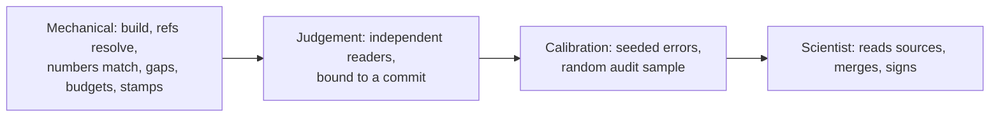
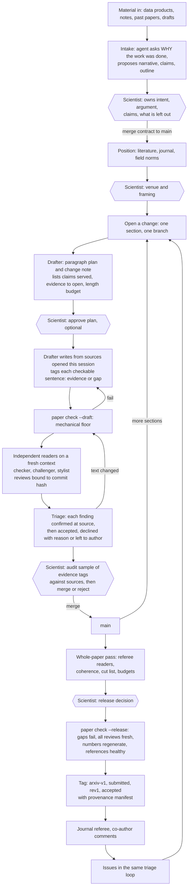

# Appendix D: clean-slate design, "the paper as a software project" (Sonnet 5.5)

_Returned whole by the subagent (read-only; designed from the intent alone, then read VISION.md and README.md for Part 10). Saved as received, 2026-11-27._

---

# A paper as a software project: a design for agent-written, scientist-accountable papers

Parts 1 to 9 were written from the intent alone. Part 10 was written after reading `docs/VISION.md` and `README.md` in `/Users/dcroton/Local/testing-grounds/ai-agent-science`. I did not read the skills, briefs or tools, so Part 10 relies on those two documents only. No files were created or edited.

## 1. Principles

1. **Responsibility is earned by a process, not asserted by a declaration.** A scientist can sign a paper they did not type if three things hold. Every checkable sentence is answerable to evidence. Someone who did not write it has checked. The scientist's decisions are on the record.
2. **The paper is the artefact, and the claims are its contract.** Prose is the implementation. The list of claims, each with the test that would support it, is the specification. The scientist owns the specification. Agents may propose changes to it but never merge them.
3. **Unevidenced must be visible.** A checkable sentence has a pointer to its evidence or an open gap. A gap is allowed in a draft and fatal in a release.
4. **Numbers are compiled, not typed.** Wherever a data product exists, a number in the prose is generated from it. This is the one place the software parallel gives a stronger guarantee than review can.
5. **The writer never certifies itself.** Review is by a fresh context, a different model where possible, bound to the exact text it read.
6. **Judgement is labelled as judgement.** A green check means "the mechanical floor holds". It never means "the paper is right". The toolkit must never display more assurance than it has.
7. **Writing up, not discovering.** Agents may rebuild a figure from the scientist's own script. They may not run a new analysis whose result nobody reviewed. Findings arrive as data products with their records.
8. **Small floor, thin ceremony.** Ordinary technology: Markdown or LaTeX, git, one stdlib script. Ceremony scales with stakes, and a solo scientist on a laptop uses the same commands with no server.

### Where the software parallel holds

**Transfers cleanly (deterministic and exact):**
- Version control, branches and merges as the record of who changed what.
- Pinned dependencies. A source is a dependency and is read at a recorded version.
- Reproducible builds: the manuscript builds, figures rebuild, numbers regenerate.
- Resolvable references: a citation key exists in the bibliography, and the bibliography entry came from an authority.
- Budgets (words per section), "no TODOs in a release", and tags and releases.
- Stale-approval dismissal. A review is bound to a content hash, and a change invalidates it.
- Code ownership and protected branches as the human gate.

**Transfers by analogy (a judgement dressed as a test):**
- "Citation check". The tool checks the key resolves. Whether the paper says what the sentence says is a reader's judgement.
- "Tests". A claim's test is a standard of evidence, not an assertion that can fail.
- Code review. Reviewers read prose without executing it, so they miss what an execution would reveal.
- Mutation testing. Seeding known errors measures reader recall, but it only samples the error types you thought of.
- Linting for style. It catches bans and counts, not voice.
- Dead-code detection. A paragraph that serves no claim is a candidate for cutting, but only a human knows whether it is context.

**Does not transfer:**
- Ground truth. Code either runs or does not, but a sentence can compile, resolve, be traced and still be wrong or misleading.
- A stable spec. In software the spec precedes the code. In a paper the spec moves as the scientist learns what the paper says, so changes to the contract must be first-class events, not drift.
- Behaviour-preserving refactoring. A cut changes meaning, so every cut is an editorial act.
- Coverage as a goal. Evidence tags can be added to every sentence and checked by nobody, which is evidence theatre. Software has the same failure (coverage gaming), but here it is worse because there is no execution to expose it.
- Users who hit bugs. A referee is the only user, and they arrive after submission.
- Whole-paper properties: coherence, omission, importance, taste. No test exists for any of them, and software offers no model.



## 2. The process as a flow

The unit of work is a **change**: a section-sized branch with a short change note. It is not a paragraph or a sentence. The scientist merges. Everything else happens inside the change or before the first one.



**The human decision points** are listed here and are not delegable.
- The intent.
- The claims and what is cut.
- The venue.
- Approval of each change.
- The audit of a random sample of evidence tags against their sources.
- Release.
- Every disposition of a finding that touches the science, the framing or the voice.

## 3. The artefacts

| Artefact | Purpose | Software analogue |
|---|---|---|
| `claims.md` | Numbered claims, each with its strength (observed, inferred, conjectured), the test that supports it, and the evidence it rests on. The contract. | Specification and acceptance tests |
| `outline.md` | Intent, narrative, role and word budget for each section, and a **cut list**: results considered and excluded, with reasons. | Design doc and roadmap |
| `sections/*.tex` (or `.md`) | The prose. Each checkable sentence carries an adjacent evidence tag. | Source code |
| Evidence tag | `% ev: <kind> <locator> [@pin]`. Kind is number, citation, comparison, other-paper, own-method or definition. Pin is a hash or version of the thing opened. A sentence with no evidence has `\gap{kind}{what would close it}`. | Assertion plus dependency pin |
| `evidence/` | Data products, run logs and the **manifest** mapping a number key to a file and a field. | Fixtures and build inputs |
| `numbers.tex` (generated) | `\num{key}` macros produced from the manifest. Magic numbers in prose are a lint error. | Generated code and constants |
| `refs/` | Bibliography exported verbatim from an authority (database, DOI or arXiv), plus a read-notes file saying what was opened and what each paper says. | Lockfile |
| `context/` | `field.md` (norms, what the field takes as given), `venue.md` (journal instructions, referee guidelines), `voice.md` (the scientist's style, distilled from past papers), and 3 to 5 exemplar papers. | Style guide and CONTRIBUTING |
| `changes/NNN.md` (or PR text) | The change note: intent, claims touched, evidence opened, gaps left, plan versus result. | PR description |
| `reviews/<commit>-<reader>.md` | Independent findings, pinned to the text hash they read. | Review comments |
| `CHANGELOG.md` | The scientist's decisions in plain sentences ("dropped the comparison to X; reason"). Short. This is the account shown to editors. | Changelog |
| `PROVENANCE.md` (generated at release) | Which sections were agent-drafted, who or what reviewed each, what the readers found and how it was disposed, and the audit samples. | Release notes and SBOM |
| `CODEOWNERS` equivalent | The contract files (`claims.md`, `outline.md`, `voice.md`, `venue.md`) and `main` are merged by the scientist only. | CODEOWNERS and branch protection |

An evidence tag is a make-style dependency. The sentence is the target and the source is the prerequisite. A tag is stale when its sentence or its pinned source has changed since the last independent check.

## 4. The checks and how independence is obtained

**Mechanical.** `paper check` is a single entry point with two tiers. It is pure standard-library Python and takes seconds.

- Build and structure
  - Does the manuscript build? Do figures rebuild from their scripts?
  - Do all citation keys resolve? Does every `.bib` entry carry an authority identifier and match its authority byte for byte?
  - Do evidence tags parse? Do their paths exist and their pins match?
- Numbers
  - Do all `\num{}` values regenerate from the manifest?
  - Are there bare numerals in prose outside an allow-list (years, section numbers)?
- Gaps, budgets and staleness
  - How many gaps are open? In `--release`, any open gap fails.
  - Are sections within their word budget? Does an unusually long paragraph serve no claim in the plan?
  - Which sections changed since their last review stamp?
  - Which tags were lost or moved in a change? A deleted tag is shown, not silently dropped.
- Reference health: retractions, newer arXiv versions and reused keys.
- `--release` adds: every review is fresh against the current hash, and no contract file differs from the scientist's last approved version.

**Judgement.** These are independent readers, each a fresh context given one narrow question and read-only access.

- **Checker.** Does the sentence say what its evidence says? It re-opens every source.
- **Challenger.** Does the claim, as worded, follow from its test? It looks for overstatement, causation from correlation, and a scope wider than the data.
- **Stylist.** Voice, flow, and what to cut.
- **Referee (red team).** It attacks the whole paper, one fresh context per angle, against the field's norms and the journal's own instructions.
- **Field reader.** It checks the assumptions the field takes for granted, which agents lack. It works from `field.md` and the exemplars.

**Independence is built from four things.**
1. A fresh context with a narrow brief and no access to the writer's reasoning.
2. A different model or vendor where one is available. This is the nearest thing to a second engineer.
3. The review is stamped with the text hash it read, so any edit invalidates it. This mirrors dismissing stale approvals.
4. **Calibration.** Two techniques estimate how much the readers miss.
   - Seeded errors: a script corrupts a handful of traced facts in a scratch copy (swapped number, wrong citation, reversed sign, strengthened verb) and records the fraction the checker catches. This reports recall, not a guarantee.
   - A random audit: the scientist opens a sample of tags against their sources. The sample is the last check, and it is the scientist's.

Every finding from a reader is a lead. It is confirmed at the source before any text changes, because readers also invent.

## 5. The roles

- **Scientist: maintainer, product owner, merger.** Owns the contract, the voice and the merges. Audits sources, not prose. Never certified by the toolkit.
- **Drafter: developer.** One section per change, from sources opened in that session. Plans first and tags as it writes. Decides nothing about the science.
- **Librarian: dependency manager.** Finds and exports references from authorities, keeps the read-notes, and runs reference health. Cites only what it opened.
- **Readers: reviewers.** Checker, challenger, stylist, field reader and referee. They never write the text they review.
- **Release engineer: a script.** `paper check`, `paper release` and `paper provenance`. It has no judgement and claims none.
- **Co-authors and journal referees** are external reporters. Their comments enter as issues through the same triage as the readers' findings.

## 6. Packaging as a toolkit repository

```
paperkit/
  AGENTS.md              # the core: <2 pages, read whole by every session and subagent
  README.md
  roles/                 # one brief per role; a reader reads only its own
    drafter.md  librarian.md  checker.md  challenger.md
    stylist.md  field-reader.md  referee.md
  playbooks/             # short, optional; read when the case arises
    intake.md  position.md  draft-a-section.md  triage.md
    whole-paper.md  release.md  respond-to-referee.md
  tools/
    paper                # one stdlib Python script, subcommands:
                         #   init, check, trace, numbers, budget, refs,
                         #   stamp, sample, seed, release, provenance
    test_paper.py
  templates/
    workspace/           # claims.md, outline.md, context/, changes/, CHANGELOG.md,
                         #   evidence/manifest.yml, Makefile, scipaper.sty, .gitignore
    change-note.md  issue-templates/
  ci/
    pre-commit           # calls `paper check --draft`
    github-workflow.yml  # calls `paper check`; required review labels
    gitlab-ci.yml
    CODEOWNERS.example
  docs/
    VISION.md  BACKLOG.md
```

- **Instructions** are `AGENTS.md`, roles and playbooks. They are Markdown that works in any harness that reads instructions.
- **Tools** are exactly one script. If a check cannot be made deterministic, it is not a tool but a reader brief.
- **Templates** are copied once and then owned by the paper.
- **CI** is thin wrappers around one command, so the laptop and GitHub run the same thing. Hooks are never bypassed.
- **Without a server**, the change note is a file, the merge is `git merge --no-ff` by the scientist, and "required review" is a stamp file written by `paper stamp` after a reader's report lands in `reviews/`.
- **Adapters** are pluggable: a literature authority (ADS, Crossref, PubMed, arXiv) and an evidence-locator kind. A field supplies its own.

## 7. The scientist's experience

**Day 1.** The scientist points the agent at their material: data, notes, a draft or a pile of results. The agent does not start writing. It asks why the work was done, who it is for, and what the reader should believe afterwards. It proposes a one-paragraph argument, a claim list with the evidence each rests on, and an outline with budgets and a cut list. The scientist corrects all of it and merges it. That merge is the contract and takes an hour or two. Claims with nothing under them become "questions with a declared test", not sentences.

**Mid-paper.** The loop repeats for each section. The scientist reads a change note, not a diff of prose. It shows the plan, the claims served, the evidence opened, the gaps left and the reader findings with their dispositions. They open a random handful of tags against their sources, then merge or send it back. Reading the whole text is reserved for the stylist's and referee's passes. A dashboard of `paper check` shows gaps, stale reviews, budgets and numbers drift. When a result changes, `paper numbers` regenerates the figures in the prose and the check flags the sentences whose claims no longer follow.

**At submission.** The scientist reads the paper straight through once, as a referee would. They run `paper check --release`, which fails on any open gap or stale review. They draw a final audit sample and approve the release. `paper release` tags `submitted-<date>`, builds the journal's bundle and generates `PROVENANCE.md` and the AI-use statement. The statement is derived from the log, not recalled. The editor gets the changelog and, if asked, the audit samples with their sources. After review, the referee's points enter as issues, go through the same triage loop, and become `rev1`.

## 8. Risks and weaknesses

- **Process tax.** A change for every paragraph would kill adoption. Mitigation: the unit is a section, solo mode skips the plan approval, and ceremony is a convention before it is a command.
- **Evidence theatre.** Tags can be added to every sentence and read by nobody. Mitigation: the scientist's audit sample, seeded errors for the readers, and pins that go stale. None of this eliminates it.
- **Green-check overtrust.** A passing `check` will be read as "correct". Mitigation: the output states what is not covered, every time.
- **Correlated blind spots.** Readers share their models' biases. Different vendors help partially. The scientist's audit remains the only independent check.
- **Approval fatigue.** The scientist rubber-stamps, as engineers do on large pull requests. Mitigation: the sample audit is mandatory for a merge, and change notes are short.
- **Data that is not machine-readable.** `\num{}` needs a manifest. Many fields, and much legacy work, lack one. Mitigation: it degrades to a tagged pointer into a log, and the lint is optional.
- **Field fit.** Evidence kinds differ for proofs, qualitative work, clinical trials and theory. The locator kinds are extensible, but the defaults reflect quantitative empirical work.
- **Spec drift.** Claims change as writing teaches the scientist. If `claims.md` is not kept current, the readers test against a stale contract. Mitigation: a claim change is a first-class merge.
- **Git hostility.** Many scientists use Overleaf or Word. Mitigation: a thin wrapper hides git, and Overleaf's git bridge is usable. Without version control the design loses its record.
- **What no check covers:** whether the science is right, whether the work matters, whether the paper omits an inconvenient result. The cut list helps with the third only if the scientist fills it in honestly.
- **Fraud.** A determined author can fabricate a coherent record. The design makes carelessness visible and does not stop dishonesty.
- **Confidentiality.** Unpublished data and manuscripts under review pass through providers. That is the author's judgement and the journal's rule.

## 9. Summary of the design in one sentence

A paper is a repository whose contract is the scientist's claim list, whose changes are section-sized and merged only by the scientist, whose build fails on any unflagged gap or drifting number, and whose every merge carries independent reviews bound to the exact text they read.

## 10. How the existing repo maps onto this design

This is based only on `docs/VISION.md` and `README.md`. I have not read the skills, briefs or tool code, so anything I say about their detail is inference.

**The two converge heavily.** The existing toolkit already has the central ideas: trace or gap with a gap failing the final build, references exported verbatim from an authority, an independent reader that did not write the text, claim strength read separately, the author deciding, writing separate from running analysis, budgeted length, and the record under version control. It also draws the same code parallel. I would not restructure it.

| Existing part | In my design | Status |
|---|---|---|
| `skills/_shared/core.md` and the eight commitments | `AGENTS.md` and Principles 1 to 8 | Kept |
| `% src:` trace and `\gap{}` | Evidence tag and gap | Kept. Mine adds a *kind* and a *pin* on the tag. |
| `tools/traces.py` (`list`, `lost`, `lint`, `stale`, `moved`, `sample`) | The mechanical part of `paper check`, plus `stamp` and `sample` | Kept. `stale` is my stale-approval dismissal. |
| `tools/ads.py` | Librarian's authority adapter | Kept, but generalise to a pluggable adapter. It is astronomy-specific while VISION claims any field. |
| `scipaper.sty` | Gap macro | Kept |
| `skeleton/paper-workspace/` | `templates/workspace/` | Kept, renamed |
| `paper/outline.md`, `paper/style.md`, `AGENTS.md` sources block | `outline.md`, `context/voice.md`, `refs/` pins | Kept. I would split `claims.md` out as the contract, if it is not already separate. |
| `readers/` (checker, challenger, stylist, referee) | Roles | Kept 1:1. I would add a field reader. |
| `revise` loop, numbered points with dispositions | Triage | Kept |
| Paper stages as "a map, not a pipeline" | Playbooks | Kept. My flow is more PR-shaped, with a section-sized change and an explicit merge gate. |
| `literature` skill and notebook | Librarian and read-notes | Kept |
| `docs/BACKLOG.md` | `docs/BACKLOG.md` | Kept |
| Commit policy in `AGENTS.md`; decision journal | CHANGELOG and change notes | Merged: one place for decisions |
| (not in README) | `\num{}` from a data manifest, `paper seed`, `paper release`, `PROVENANCE.md`, CI and hook wrappers, reference health, cut list and dead-paragraph check, scientist-only merge on contract files | Added |

Nothing needs dropping. The one thing I would resist is any part of mine that adds ceremony the repo has deliberately avoided (see the last paragraph below).

### Ideas I would most urge the owner to adopt

1. **Numbers compiled from data products (`\num{}` and a "no bare numbers" lint).**
   - Expected benefit: it removes the largest silent-error class in quantitative papers, which no reader reliably catches. The scientist then audits the manifest once instead of every sentence.
   - Confidence: high for fields with machine-readable results, medium overall.
   - Complexity: medium.

2. **Seeded-error calibration of the readers.**
   - Expected benefit: VISION admits "the readers are only as good as the models behind them", and this gives a measured recall instead of an assertion. It also makes a vendor or prompt change testable.
   - Confidence: medium. It samples only the errors you think to seed.
   - Complexity: low to medium.

3. **One `check` command with draft and release tiers, reviews bound to a content hash, and thin pre-commit and CI wrappers.**
   - Expected benefit: the same assurance on a laptop and on GitHub, and one thing to run before submission. It generalises `stale` into a rule that any edit voids a review.
   - Confidence: high.
   - Complexity: low to medium.

4. **A generated `PROVENANCE.md` and AI-use statement at release.**
   - Expected benefit: it serves the stated intent of showing editors a record, not a declaration, and cuts the author's writing burden.
   - Confidence: medium to high. It depends on keeping the log clean, and editors' appetite is unproven.
   - Complexity: low to medium.

5. **Scientist-only merge on contract files (CODEOWNERS and a protected `main`).**
   - Expected benefit: it enforces "the author decides" instead of asking agents to respect it. It matters most when the agent harness has write access to everything.
   - Confidence: high.
   - Complexity: low.

6. **A cut list and a dead-paragraph check against the claim plan.**
   - Expected benefit: it answers the stated agent weakness of not knowing what to leave out, by making omissions a decision on the record.
   - Confidence: medium. The mechanical proxy is crude and the cut list needs honesty.
   - Complexity: low.

7. **Reference health (retractions, new versions).**
   - Expected benefit: it catches a cited paper that has been retracted or superseded since it was read.
   - Confidence: medium.
   - Complexity: low.

On ceremony: the repo's own principles (empower the agent, grow only where use shows friction, a tool only where failure is silent) are the right brake. Items 1, 3 and 5 pass that test because their failures are silent. Items 2, 4, 6 and 7 should wait for real friction before being built.
