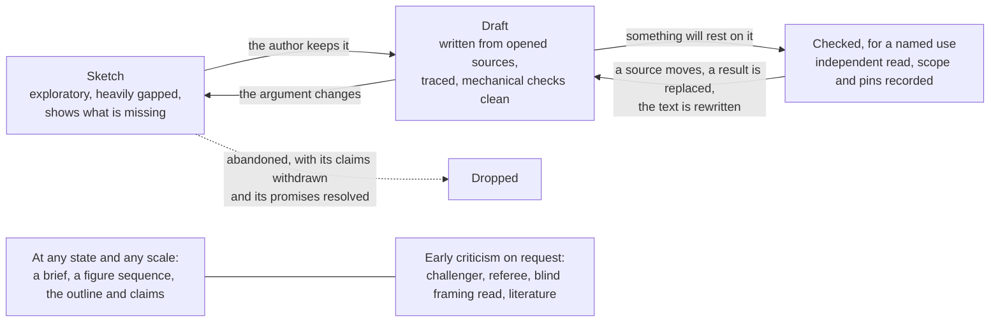
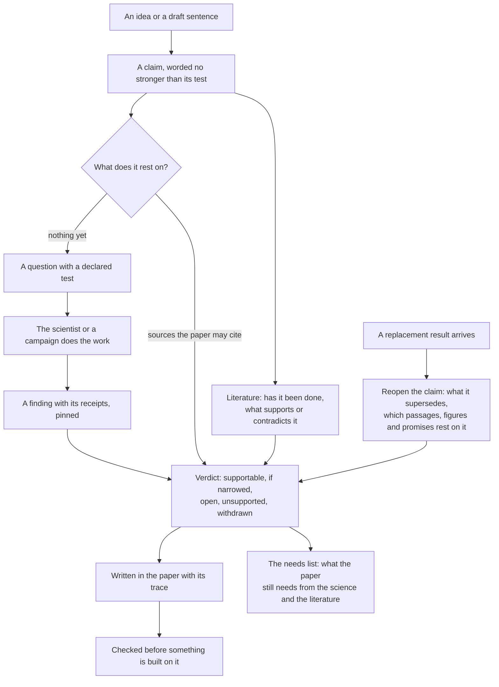
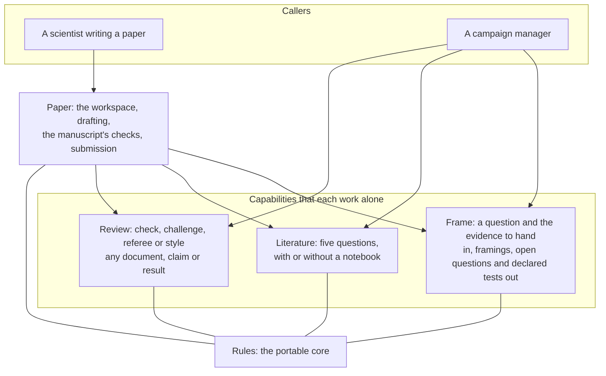

# Reflecting on the toolkit: does it serve its purpose?

**For:** the owner's review. **Date:** 2026-11-27, second version. **Status:** a proposal; nothing in the toolkit has been changed.

This version replaces the first (`superseded/REFLECTION-v1.md`), which was written before the owner stated the full purpose and which leaned too hard on one unattended test paper. It is rebuilt from the purpose down. Ideas from the first version that do not fit the purpose have been removed, and Section 8 lists them so that nothing disappears silently.

## The owner's decisions, 2026-11-27

Recorded after the owner read this document. They govern the implementation on the branch `purpose-fit`.

- **Section 1 stands as the purpose, with one change.** Point 5 is withdrawn: nothing in the toolkit should favour one kind of paper. Every kind is served, and the agent fills what a particular paper needs under the design stance (point 6). The vision does not rank use cases.
- **All three versions are to be implemented in full**, one at a time, each reviewed for fitness to the purpose, with no bloat.
- **The three states and the trigger for a check are accepted** (Section 6, Version A).
- **The backlog's live items are done in the same round**, in proportion.
- **The framework paper was a test.** Nothing further is done in its workspace.

## 1. The purpose everything is judged against

In the owner's terms, 2026-11-27:

1. **Responsibility.** A scientist can be fully responsible for a paper they did not type. They decide the science, the argument and the voice. Every checkable sentence stays answerable to its evidence, and what has no evidence is visible.
2. **Lock-step with the science.** The paper is written beside the code, data and results, or with access to them, and the science is often not finished. Writing helps find the most interesting questions. Sections are abandoned and rewritten as the work evolves. The toolkit must meet the scientist where they are, whether the results are complete or still developing.
3. **Finding gaps.** Part of its job is to find gaps in the literature or in the scientist's own work, for the scientist to act on.
4. **Parts that stand alone.** Each skill and tool should be useful outside a paper, for example to a campaign manager who wants a literature search, help framing an idea, a claim tested or a result refereed. This matters as much as the paper workflow.
5. **Use cases.** Science results papers first. Infrastructure, tools and data-release papers second.
6. **Design stance.** Empower the agent and do not over-prescribe. Grow only where use shows a real gap. Ordinary technology. A generic toolkit and a particular workspace.

## 2. Short answers

**Is the toolkit right for this purpose?** Largely yes, and more than the first version of this document said. The procedures already carry most of the lock-step design. A claim with nothing under it becomes a question with a declared test for the author or a campaign (`evidence.md`). Findings come back pinned and are checked against their receipts. A draft with gaps is the stated target. "A short outline and a long list of questions is a good outcome" (`start.md`). The readers and the literature skill can already be commissioned outside a paper (`review.md`, *Outside a paper workspace*).

**What is wrong?** Four things, in order of importance.

- **The vision states one of the four purposes.** `VISION.md` is about responsibility. It does not say the toolkit works alongside unfinished science, that finding gaps is an outcome, or that its parts stand alone. Its non-goal says the toolkit "writes up work that someone has done".
- **The same full treatment is applied to all text, however settled it is.** `draft.md` sends every drafted section to the stylist and then the checker before it is "called drafted". For a paper whose shape is still moving, that verifies and polishes text that will be cut or rewritten. Both workspaces show it.
- **Science that changes has no clear way back in.** A tracked file that changes under a trace is reported (`traces.py moved`). A replacement result is different: nothing records which result supersedes which, so nothing tells the paper which one the scientist now intends to use, or which passages rest on the old one.
- **The parts that stand alone are hard to find and to enter.** A campaign manager's harness sees a skill called `paper` that "writes a journal paper". The readers sit inside it. Every caller is told to read a core document that is mostly about the paper workspace.

**Is "a map, not a pipeline" right?** Yes. The first version of this document argued for a lifecycle with gates. That was wrong for science that develops as it is written, and it is withdrawn.

**Where should the agent not imitate a person?** In matching effort to reliance. A person re-reads everything they wrote. An agent can sketch cheaply to expose what is missing, and should spend the expensive independent check on text someone is about to rely on.

## 3. The evidence and its weight

| Source | What it is | Weight |
|---|---|---|
| The framework paper (`ai-agent-science-paper-workspace/`, commit `dcc3f06`) | A deliberate, largely unattended test on an unusual paper: no results, one author, about the toolkit itself | A stress test of the machinery. Not the expected use. |
| The Mimic paper workspace (`mimic-paper-workspace`, read-only) | Two weeks of supervised use on a platform paper whose demonstrations wait on campaigns: 54 commits, five campaigns read in, 663 traces, 39 gaps | The best record of intended use. A secondary-case paper (a platform), with primary-case features (results arriving from campaigns). |
| An independent review (Appendices F and G) | Codex CLI on `gpt-6.2-sol` at high effort, read-only, given the purpose above and told to review the toolkit top-down before reading this document's first version. It then checked this version. | A different model provider. It did not see Mimic. |
| Five agent reports (Appendices A to E) | An audit, three clean-slate designs and a usability probe, all from one model family, all written before the purpose was stated | Leads only. Several of their conclusions do not survive Section 1. |

No science results paper has yet been written with the toolkit from start to submission. Section 9 says what that leaves untested.

### What the first version got wrong

Reading Mimic and the owner's clarification overturned these findings. They were effects of the unattended test, not faults in the toolkit.

| First version said | What the fuller evidence shows |
|---|---|
| The record depends on git, and git barely recorded | Mimic has 54 commits in two weeks under per-task grants. The three commits were the test's commit policy. |
| The author's gates were abandoned, so design four gates with delegation as the default | The author was absent by design. Delegation should stay explicit and bounded, as `core.md` rule 5 has it. |
| Style points were approved without the author | In Mimic the owner reviews the stylist's reads against the science focus. |
| Comments and revision history swamp the source | Mimic's section files have five-line headers and comments at well under the volume of the prose. |
| The outline's spine and the claims table duplicate each other | True for a 12-claim methods paper. Mimic's claims table holds 46 rows with campaign verdicts and does a different job from its nine-line spine. |
| Add a figure-led start, and alternatives at the decisions that shape the paper | Both are already practice. `start.md` returns the framings considered, Mimic's outline has *Figures* and *Demonstrations*, and the owner was given the science-focus options side by side. |
| "Three traced sentences in ten were flawed" | The count was 83 findings across about 273 traced lines. Several findings can sit on one sentence, so the rate is not known. The checks found real errors. The only measure of what a checker misses is Mimic's one seeded test, which found 3 of 5 planted errors. |

### What holds in both workspaces

- **The independent check finds real errors**, and confirming each finding at source stops a wrong finding becoming a wrong fix. In the test, a false superlative was caught, and a checker's page correction was declined at source.
- **Text is checked before its shape is settled.** In Mimic, the drafted sections were checked from 19 November. The science focus was settled and then revised on 23 November, every drafted section stands at 1.5 to 2.1 times its budget, and the draft now waits for the calibration results and a cut in one pass. In the test, sections were checked before the whole-draft review changed them.
- **Agents overrun their budgets.** Mimic: 1.5 to 2.1 times. The test: up to 43% over after review.
- **Results move under the paper.** In Mimic, a simulation data set was reissued and a count the paper states changed from 299,185,269 to 299,210,551. The affected lines are tracked by hand in `STATE.md`.
- **Working memory grows.** Mimic's `STATE.md` is 1,927 words against a two-page rule, its journal 16,500 words, its open questions run to Q79.
- **Drafting from sources finds gaps in the work itself.** Drafting Mimic's methods sections found eleven places where the software's guides disagree with its code. This is purpose 3 working, though no toolkit text names it as an outcome.

## 4. The toolkit, layer by layer

Each layer is judged by whether it serves the layer above. The independent reviewer (Appendix F) and I reached the same main findings separately.

### The vision

`VISION.md` serves purpose 1 well: the commitments, the roles and the split between what is mechanical and what is judgement are right and should stay.

It does not state purposes 2, 3 or 4. The parallel with code puts "the outline and the claims agreed before the prose", which reads as one linear pass. The non-goal "it writes up work that someone has done" contradicts purpose 2 as worded. Gaps appear only as a property of honest prose, not as something the scientist is handed to act on. Independent use appears in the README and not in the vision.

### The architecture

Two skills (`paper`, `literature`), one shared core, two tools and a LaTeX package.

- **The map is right.** Its stages can be entered in any order, which is what developing science needs. Its weakness is that it does not tell a returning scientist with a new plot, or a campaign manager with an idea, where to go.
- **The core mixes two things.** Seven of its rules are portable: trace or gap, references from an authority, the writer does not check itself, claim strength, the author decides, read and do not run, shorter without silent omission. The rest is the paper workspace: file layout, session start and end, LaTeX trace forms, commit policy. Every caller is told to read all 1,900 words.

### The procedures

| Procedure | Serves the purpose | Falls short |
|---|---|---|
| `start.md` | Good with thin, untidy material. Asks why before proposing. | Its four questions (why the work was done, what surprised you, who must be convinced, who the authors are) are asked once and do not ask about the science as it stands. A scientist mid-investigation also needs: what are you trying to establish now, what is provisional, what decision could writing clarify? |
| `evidence.md` | The bridge between paper and science, and the strongest part for purposes 2 and 3. Mimic has used it for five campaigns. | No entry for a replacement result that arrives before any prose changes. Its declared-test checklist assumes an experiment; a derivation or a data-release coverage check needs different items. |
| `draft.md`, `sections.md` | A gapped draft is the target. A provisional introduction may be drafted early and "is not checked until the body is". | That permission covers the introduction only. Everything else gets the full sequence. |
| `review.md`, `revise.md` | One loop for every reader. Outside a workspace the protocol already takes pinned inputs and a returned report. | Inside a workspace, a routine read needs committed manuscript text (plans, outlines and seeded tests are excepted), so approval at the session's end delays reads. `revise.md` measures change against a commit. |
| `finish.md` | A proper submission boundary. | Untested. Does not say who draws the audit sample, what it is drawn from, or what follows a failed draw. |

### The briefs, techniques and tools

The four reader briefs are the most reusable parts of the toolkit. Their openings are written in paper terms even though each accepts other inputs. The challenger has no verdict for "the evidence was not accessible" or "the test is still open".

`traces.py` is rightly narrow. Three precise faults: quoted text in a trace is never compared with its source; `lost` reports a deleted gap marker as "gap closed" whatever the reason; one source file cannot be excluded, only a directory. `ads.py` stands alone already.

## 5. Can each part be used alone?

| Part | Alone today? | What it silently depends on | Smallest change |
|---|---|---|---|
| `literature` skill | Yes. The notebook is optional. | The whole core; an ADS token | Lead with the no-notebook path. Allow exploratory questions before a headline result exists (comparable tests, what is open). |
| Challenger | Yes, on a claim and what it rests on | Opening text names workspace paths | State its inputs first. Add a verdict for missing evidence. |
| Referee | Yes, including on a result before any paper | Venue and field files, if wanted | State its inputs first. Say in its coverage what it lacked. |
| Checker | Yes, on any document that cites its sources | Trace forms written for LaTeX | State its inputs first. |
| Stylist | Yes, in document mode, which already covers briefs and plans | Narrative and style files, if wanted | Name outlines and proposals among its examples. |
| Framing an idea | **No.** The pieces exist inside `start.md`, `evidence.md` and the stylist's outline mode, but only as steps in starting a paper. | A paper workspace | An entry that takes a question and the evidence to hand, and returns candidate framings, open questions and declared tests, with no workspace. |
| `field`, `venue`, `style-sheet` techniques | Mostly. The methods are portable. | Paper paths for their output | Let the caller name the destination. |
| `subject-repository` technique | Partly, as a capability or provenance audit at a pin | A manuscript, for its mapping to sections | Supply a revision, the questions and a destination. |
| `many-drafters` technique | Partly. One owner for each shared file, and re-reading inputs that changed, apply to any parallel writing. | Section files, claim ids and a TeX build | Offer the coordination rule as a short extract. |
| `ads.py` | Yes | A token | Make the partial-export exit status prominent. |
| `traces.py` | Partly: `list` and `sample` work on named files that use the trace syntax. | `lint` and `moved` need a `sources` block; `lost` and `stale` need git. Another repository could supply these. | Document the subset that works alone and what the rest need. Add inputs only when a campaign needs them. |
| `scipaper.sty` | Yes, in any LaTeX document | The `xcolor` and `marginnote` packages | None. |

Two things block independent use more than any single part. A harness finds skills by their description, and nothing but `paper` and `literature` is described. And the first instruction to every caller is to read a core that is mostly about a paper workspace.

## 6. Three alternative versions

They change different things: the workflow, the flow that connects paper and science, and the packaging. They can be combined. None changes the eight commitments, the trace and gap form, export-only references, the reader briefs or "a finding is a lead".

Scores: **confidence** that the change delivers its benefit; **complexity** to make (low is wording; medium is several files or a tool subcommand; high is a new mechanism). **Basis** names the support: *Mimic*, *test* (the framework paper), *review* (Appendix F) or *reasoning*.

### Version A: Effort follows reliance

**The idea.** Keep the map and the two skills. Give every piece of text a state the author can see, and let the readers follow the state instead of a fixed sequence. What calls for an independent check is that something is about to rest on the text: a decision, another claim, the framing sections, submission.

- **Sketch.** A visibly provisional question, outline, figure sequence or passage. Its factual assertions still carry a trace or a gap. The scientist can explore alternatives and ask for early criticism without promoting it.
- **Draft.** The writer has opened the sources, recorded traces or gaps and run the mechanical checks. Whether each source supports its sentence is still unread.
- **Checked, for a named use.** Before a factual claim drives a decision or supports another claim, an independent reader checks it, and the record names the scope, the version of the text and the evidence pins. The scope returns to unchecked when its wording, its evidence or its interpretation changes. A source that cannot be opened leaves its claim unchecked. Submission keeps its full checks.

The third state is named for what was checked, as the independent reviewer advised (Appendix G): "relied on" describes what someone did and can hide what was actually read.

| # | Change | Reason | Expected benefit | Basis | Confidence | Complexity |
|---|---|---|---|---|---|---|
| A1 | Name three states (sketch, draft, checked for a named use) in `draft.md` and the state table, generalising the provisional introduction | Full treatment is applied to text that is then cut or rewritten | Checking and polish go to text that will survive; a sketch becomes a legitimate way to find what is missing | Mimic, test, review | high | low |
| A2 | Change "every drafted section goes to the stylist and the checker" to a check before a claim drives a decision or supports another claim. Exploratory feedback on labelled provisional text needs no blanket check. | The fixed sequence is the one place the map is a pipeline | The author chooses when to pay for a check, and what was checked is on record | Mimic, test, review | medium | low |
| A3 | Defer the cut and sentence-level polish until the shape is settled, as the owner did in Mimic ("cuts after the focus"). Planning estimates and an early style read stay available. | Budgets set before the focus are guesses | One cut on the right shape, not polish on the wrong one | Mimic | medium | low |
| A4 | Carry the drafter's existing overrun report (`draft.md`, step 4) into the state file for each changed section, with the workspace's one counter, and mark budgets provisional until the shape settles | Overruns of 1.5 to 2.1 times accumulate | The overrun stays in front of the author | Mimic, test | medium | low |
| A5 | Offer early criticism at the scale of what exists, with a line on when each pays | The options exist and were skipped in the test; Mimic's state file offers the referee "earlier if the owner asks" | Scope, novelty and overclaim are met while they cost a page | test, review | medium | low |
| A6 | Let a reader be given a named, unchanging copy with its evidence pins when the text is not committed. `revise.md` then compares against that copy, and `stale` goes on reporting an uncommitted stamp as such. | Approval at the session's end delays routine reads | Reads do not wait on commits; the owner's commit rule stands | test, review | high | medium |
| A7 | Make "the reader returns its report and the session files it as received" a normal path | Some harnesses refuse subagent file writes | Works in more harnesses | test, review | high | low |
| A8 | Pilot a check that each quoted phrase in a trace appears in its pinned source text, reporting what it could not read. Whether the source supports the sentence stays a reader's judgement. | Checkers confirmed over 300 quotations by eye | Exact, repeatable, and less for the reader to do | test | medium | medium |

**How the current repository maps.** Nothing moves. `draft.md`, `sections.md` and one sentence of `core.md` change wording. The scaffold's state table gains a state and the overrun report. `review.md` and `revise.md` gain the unchanging-copy path. `traces.py` gains a quote check only if the pilot works.

**Risks.** The trigger needs a clear meaning or agents will defer every check; the definitions above are a first attempt and untested. An unchecked draft can mislead a reader who forgets its state, so the state must show in the build as gaps do.

### Version B: The claim's life

**The idea.** Organise the guidance around what actually travels between the science and the paper: the claim. A claim starts as an idea, becomes a question with a declared test, goes to the scientist or a campaign, comes back as a finding with receipts, receives a verdict, is worded in the paper and is checked. Finding gaps is this loop running outward. Absorbing a changed result is the loop running back.

| # | Change | Reason | Expected benefit | Basis | Confidence | Complexity |
|---|---|---|---|---|---|---|
| B1 | A return route for changed science in `evidence.md` and `revise.md`: a new result names the claim it answers and what it supersedes; the claim is reopened and the affected passages, figures and promises are listed before any edit | Nothing records which result supersedes which, and a re-pin alone does not settle it | The paper follows the science without hand-kept lists of affected lines | Mimic, review | high | medium |
| B2 | A short "what the paper needs" view in the state file, drawn from items that already exist: open claims, gaps by kind, open literature questions, each with who could close it | Purpose 3 has no named output; Mimic keeps this by hand in a 1,900-word state file | The scientist and a campaign manager see the list to act on | Mimic, reasoning | medium | low |
| B3 | A present-tense question about the science, asked at the start and again on each return: what is being established now, what is provisional, what decision would writing clarify | `start.md`'s questions are asked once and do not cover the science as it stands | The toolkit meets a scientist mid-investigation | review | medium | low |
| B4 | Choose the declared-test checklist by the kind of question: an experiment, a derivation, a data-release coverage or provenance check | The checklist assumes sample sizes, thresholds and holdouts | Serves theory and the secondary use cases | review | medium | low |
| B5 | One *open* verdict for the challenger, with its reason stated: the evidence was not accessible, or the test is still pending | Its three verdicts hide this in coverage notes | Honest verdicts on developing work | review | medium | low |
| B6 | For a consequential claim open to selective evidence, the challenger asks whether contrary evidence was sought, and hands that to the literature skill's support-or-contradict question | A sentence faithful to a well-chosen source can pass the checker and the challenger | Narrows the selective-citation hole using a part that exists | test | medium | low |
| B7 | Name "what drafting found in the work" as an outcome. Disagreements between a subject's guides and its code go on the existing list for its owner (`subject-repository.md`); gaps in the science stay as open questions. | Mimic's drafting found eleven disagreements between guides and code | Purpose 3 served for the scientist's own work | Mimic | medium | low |

**How the current repository maps.** `evidence.md` becomes the centre of the paper skill's map instead of one stage among nine. `claims.md` is unchanged in form. `revise.md` gains an entry for a changed result. `start.md` gains three questions. The challenger brief gains two verdicts and one attack. The scaffold's state file gains a section.

**Risks.** The claims table can grow heavy: Mimic's is 7,100 words. The needs list must be derived from what exists, or it becomes a second place for the same truth.

### Version C: Capabilities

**The idea.** Organise the repository by what a caller can ask for, so that a campaign manager finds and uses a part without knowing the paper workflow. The paper skill becomes one composer of capabilities that also work alone.

| # | Change | Reason | Expected benefit | Basis | Confidence | Complexity |
|---|---|---|---|---|---|---|
| C1 | State each brief's and technique's inputs first: the task, the inputs and their pins, what may be cited, the decision sought, where the report goes, who decides | The briefs accept these already and open in paper terms | A caller outside a paper can commission one from its first paragraph | review | high | low |
| C2 | Split the core into portable rules and the paper workspace contract. The portable part keeps the obligations that cut across everything: confirmed testimony, claim strength, and the boundary around producing results. | Every caller reads 1,900 words; the probe and the reviewer both flagged the load | A campaign reads a page; a paper session reads both | review, test | medium | medium |
| C3 | A `review` entry a harness can find, pointing at the existing readers and their protocol. The commissioner owns the disposition; the manuscript's revision machinery stays with paper calls. | The readers are discoverable only through `paper` | Purpose 4 for the most reusable parts | review, reasoning | medium | low |
| C4 | A framing entry that needs no workspace | The owner's own example of independent use, and the one capability that does not stand alone | A campaign can explore an idea with the same discipline | review, reasoning | medium | medium |
| C5 | Three worked calls in the README: frame an idea, challenge a claim, referee a result | Nothing shows a standalone call | Makes independent use concrete | review | medium | low |
| C6 | Document which `traces.py` commands work on named files without a workspace, and what the others need | `list` and `sample` do; the rest need a `sources` block or git | Honest scope; no new code until a campaign needs it | review | high | low |

**How the current repository maps.**

| Now | In Version C |
|---|---|
| `skills/_shared/core.md` | Two files: the rules, and the paper workspace |
| `skills/paper/readers/`, `review.md`, `revise.md` | Unmoved, or moved under a `review` skill; either way reachable through a `review` entry |
| `start.md` steps 3 and 4, `evidence.md` *A claim with nothing under it*, the stylist's outline mode | Also reachable through a framing entry |
| `skills/paper/SKILL.md` | The composer: it calls the capabilities and owns the manuscript |
| `skills/literature/` | Unchanged apart from its opening |
| `tools/`, `skeleton/` | Unchanged |

**Risks.** More entries mean more surface to keep consistent. BACKLOG decided against "a procedure each for framing, style and venue"; C4 is an entry point to existing steps, not a new procedure, and should stay that small. Splitting the core touches every file that cites a rule by number.

### The three compared

| | A: Effort follows reliance | B: The claim's life | C: Capabilities |
|---|---|---|---|
| Changes | When readers read | How science and paper exchange | How parts are found and entered |
| Serves most | Purpose 2 | Purposes 2 and 3 | Purpose 4 |
| Support | Both workspaces and the review | Mimic and the review | The review and reasoning |
| Size | Wording, one tool pilot | Two procedures, one brief | Restructuring of entries and the core |
| Main risk | Checks deferred too long | A heavy claims table | More surface |

## 7. What I would do

All three, in this order. They do not compete, and the first two rounds are almost all wording. The order follows the independent reviewer's advice (Appendix G): standalone use starts in the first round beside the paper workflow, because it matters as much, and reads without a commit come before the change in when text is checked.

| Round | Change | Why here | Confidence | Complexity |
|---|---|---|---|---|
| 1 | State the full purpose in `VISION.md`, the README and the skill map (Section 8) | Every other change is judged against it, and today it is written nowhere | high | low |
| 1 | B1: the return route for changed science | The largest functional gap for the primary use case, and Mimic needs it when the calibration results arrive | high | medium |
| 1 | C1, C5, C6: inputs first in every brief; three worked standalone calls; the honest scope of `traces.py`. Then run two real calls from a campaign: a review, and a framing with no workspace. | Purpose 4 at the cost of wording, and the two calls show what C2 to C4 must provide | high | low |
| 2 | A6, A7: reads without a commit; reports returned as text | Removes two workarounds without touching the owner's commit rule, and A1 needs them | high | medium |
| 2 | A1, A2, with A5: the three states, a check before a claim is built on, and early criticism easy to ask for | Removes the one fixed sequence; run as a trial, because the trigger is untested | medium | low |
| 3 | B2, B3, B5, B6, B7: the needs list, the present-tense question, the challenger's *open* verdict and contrary-evidence attack, what drafting found | Purpose 3 given named outputs | medium | low |
| 3 | A3, A4: the cut once the shape is settled; the overrun report in the state file | Verbosity is the most consistent failure in both workspaces | medium | low |
| 4 | C2, C3, C4: split the core; a `review` entry; a framing entry | The larger restructuring, informed by the two calls in round 1 | medium | medium |
| As met | The contract faults: the README's loop order; the scaffold state file that routes to `start`; `lost` calling a deleted gap "closed"; a single-file exclusion; backticks in traces; who draws the audit sample, from what, and what follows a failed draw | Each is a precise ambiguity with a small fix | high | low |
| Later | A8, B4: the quote-check pilot; declared tests by kind of question | Useful, and neither blocks anything | medium | medium |

**Then validate on live work.** Mimic is the natural trial, because its calibration campaign is about to return results into a paused draft. Exercise an unresolved claim, a replacement result, a section cut or dropped, and one standalone call from inside a campaign. Record what the scientist had to decide and how long it waited, which findings changed the paper, and what was reworked. The first science results paper should follow, started while some of its science is still open.

## 8. Changes to the vision, and what was dropped

### The vision

| Where | Change | Why | Confidence | Complexity |
|---|---|---|---|---|
| *Why This Toolkit Exists*, *What This Toolkit Is* | State that it works beside science that may be unfinished, that writing is one way the questions are found, and that it meets the scientist where they are | Purpose 2 is unstated | high | low |
| A new short section | Finding what is missing, in the literature and in the work, is an outcome handed to the scientist | Purpose 3 is unstated | high | low |
| *Who It Serves* | Add the campaign manager and anyone who needs one part. Name the use cases and their order. | Purposes 4 and 5 are unstated | high | low |
| *Non-Goals* | Replace "it writes up work that someone has done" with: it writes and does not do the science; results come from the scientist or a separate investigation, finished or not | The current wording contradicts purpose 2 | high | low |
| The parallel with code | "The outline and the claims agreed before the prose" describes one drafting pass, not the whole investigation; say so. The trace is a test's fixture and the independent comparison is its run. | Reads as linear; the test's referee showed the first row claims too much | high | low |
| *Guarantees*; editors | Word the mechanical guarantees as the code has them. "A record the author can choose to show." | Already in BACKLOG | high | low |
| The commitments | Group them in the text as the owner grouped them for the paper. Do not renumber the operating rules; cite rules by name from now on. | The grouping explains them; renumbering for one paper would churn every file | medium | low |
| Principle 4, "A map, not a pipeline" | Keep. State which checks an intended use requires, and leave their timing and scope flexible. | It is right for developing science | high | low |
| Commitment 6 | Say that small read-only derivations from pinned outputs are allowed, as core rule 6 has it | The vision omits the exception the core grants | high | low |

### Dropped from the first version

| Idea | Why it does not fit |
|---|---|
| A lifecycle of five phases with four author gates | Assumes a linear paper and an absent author |
| Delegation as the default between gates | Generalised from one unattended run |
| The agent commits freely; the author approves by tag | Changes the scientist's authority over commits to solve a problem that a stable review copy solves |
| A required early panel before any drafting | A required step in a map; kept as an offered read (A5) |
| "Verify once, at the freeze" | Evidence keeps changing; replaced by checking before reliance |
| A whole zero draft in place of paragraph plans | Kept only as the sketch state, at whatever scale helps |
| One argument file | Over-fitted to a small methods paper |
| Sentences anchored to claim ids | Upkeep without closing drift in meaning |
| Branches, change notes and author-only merges | A branching routine imposed on a scientist editing live text |
| A hook that runs checks on every commit | Draft commits preserve unfinished work |
| The author disposes of the first section's style points | Generalised from the unattended run |
| A values file for numbers | Not dropped, but not proposed now: there is no evidence for it yet. Worth a trial where the scientist's outputs are stable and machine-readable. A value's version, convention and interpretation would still need a reader. |

## 9. What is still untested

- **A science results paper**, from open questions to submission.
- **Science that changes the argument mid-draft**, and the return route proposed in B1.
- **A standalone call from a campaign.** The protocol exists; no record of one was read for this document.
- **Co-authors, `finish.md` and the reply to a journal.**
- **How much the checker misses.** Mimic ran the planted-error recipe in `review.md` once: the checker found 3 of 5, and its brief was strengthened for the two kinds it missed. The test paper did not run it. Five plants is a small sample.
- **Whether the trigger for a check can be defined crisply enough** that agents neither over-check nor defer.
- **This document.** The independent reviewer checked this version once (Appendix G) and judged it fit for the owner's review; its corrections are applied. It could not verify anything this document says about Mimic.

## 10. Decisions for you

1. **Is Section 1 the purpose as you would state it?** It will go into `VISION.md` nearly as written.
2. **The three versions.** All three in the order of Section 7, or a subset?
3. **States.** Are *sketch*, *draft* and *checked for a named use* the right three, and is "a claim is about to drive a decision or support another claim" the right trigger for a check?
4. **Capabilities.** Wording only at first (C1, C5), or the restructuring too (C2 to C4)?
5. **The trial.** Mimic when the calibration results arrive, with one standalone campaign call?

## Appendices

Each is kept whole, as received. A to E predate the owner's statement of purpose and should be read as leads.

- [A: audit of the toolkit against the test paper's record](A-audit-of-toolkit-and-paper-record.md)
- [B: clean-slate design, agent-native](B-design-claim-first-agent-native.md)
- [C: clean-slate design, scientists' practice](C-design-scientist-practice-opus.md)
- [D: clean-slate design, the paper as a software project](D-design-paper-as-software-sonnet.md)
- [E: usability probe by a weaker model](E-usability-probe-haiku.md)
- [F: independent top-down review, Codex `gpt-6.2-sol`](F-independent-review-codex-gpt-6.2-sol.md)
- [G: the same reviewer's check of this version](G-independent-check-of-v2-codex-gpt-6.2-sol.md)
- [The first version of this document](superseded/REFLECTION-v1.md), which Appendix F cites by line
