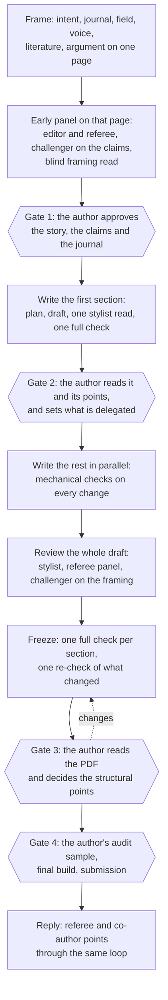
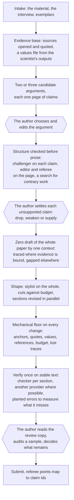

# Reflecting on the toolkit after its first paper

**For:** the owner's review. **Date:** 2026-11-27. **Status:** a proposal; nothing in the toolkit has been changed.

**Evidence:** the framework paper written with the toolkit (workspace commit `dcc3f06`: 296 traces, 62 gaps, 55 exported references, 85 journal entries, 17 friction notes), the toolkit at `8bd48c0`, and five independent agent reports kept whole in Appendices A–E.

## 1. Short answers

**Have we got the right workflow, groupings and justification?** The commitments and the mechanism are right, and the paper's record supports them strongly. The order in which the work is done is not right. The toolkit polished and verified prose before the paper's structure had been attacked, so the cheapest criticism arrived last. The grouping of the commitments that you proposed for the paper (four that carry over from code, four that writing needs beyond code) is a better justification than VISION's flat list of eight, and the toolkit should adopt it.

**Are the stages appropriate for their goal?** The nine stages mix two kinds of thing: what the scientist does (orient, position, draft, finish, respond) and who reads the text (verify, style, referee). "A map, not a pipeline" is half true. Inside a section the toolkit prescribes a strict sequence, and I followed it exactly for every section. The honest description is a fixed inner loop inside a flexible outer lifecycle, with a small number of author gates.

**Do they match how scientists work?** Partly. The match is good where it matters: the story, the point-by-point reply to a reader, framing written last, questions that arrive with a recommendation. It is poor in vocabulary, in the number of files a scientist appears to have to understand, and in having no named moments where the author decides. You resolved the last one yourself by delegating everything between the outline and the full draft. The toolkit should be designed around that behaviour.

**Where should the agent not work like a human?** In three places.

- A person plans in detail because drafting is expensive. For an agent drafting is cheap and checking is expensive, yet the toolkit had drafters write 25,600 words of paragraph plans for a 6,500-word paper.
- A person verifies as they write. An agent should verify once, on text that has stopped moving.
- A person re-reads quoted phrases by eye. The checkers confirmed over 300 quoted phrases by reading them, which a script can do exactly.

**Is there a better organisation?** Yes, and it is mostly reorganisation, not new machinery. Section 5 gives three alternative versions. Section 6 recommends one as the base, with named parts of the other two.

**A caution on generality.** This is one paper, and an unusual one: a methods paper about the toolkit itself, with no results, two figures, one author and no submission yet. It exercised orient, position, draft, verify, style and referee. It did not exercise results and numbers, figures, co-authors, finish or the reply to a journal. Section 8 lists what it cannot tell us.

## 2. How this was done, and what was checked

Five agents worked independently and read-only. Three designed a framework from the intent alone and read `VISION.md` and `README.md` only afterwards, to write their mapping. I then checked their claims against the repository and the paper's record before using them.

| Appendix | Agent | Model that ran | Task |
|---|---|---|---|
| A | Audit | Opus 5.5 (Fable requested) | Read the whole toolkit and the paper's record; judge what worked and what did not |
| B | Clean-slate design, agent-native | Opus 5.5 (Fable requested) | Design for the best outcome, not for imitating a human author |
| C | Clean-slate design, scientists' practice | Opus 5.5 | Design from how research groups write papers |
| D | Clean-slate design, paper as software | Sonnet 5.5 | Take the software parallel literally |
| E | Usability probe | Haiku 5.5 | Follow the toolkit as written and report every confusion |

Two limits apply to this evidence.

- **The models were less varied than intended.** The harness ran both Fable requests on Opus, twice. This session was then switched to Fable 5.2 for the checking and the synthesis. So the three designs come from one model family, and their agreement is weaker evidence than it looks.
- **I am not a fresh reader.** I orchestrated the paper. My own observations are marked as such below.

### What the checking changed

Every count in the audit that I re-ran is correct: 83 findings in the first full checks, 25,592 words of paragraph plans, 97,300 characters of comments against 54,800 of prose in sections 1–7, a 63-line comment header on `04_workflow.tex`, and a 7,281-word `venue.md`. Six claims by the agents were wrong or too strong.

| Claim | Who | What the files show |
|---|---|---|
| The scope problem for PASA arrived only at the milestone | A | Too strong. `venue.md` flagged the scope risk on day one (journal line 17) and you decided to keep PASA with a presubmission enquiry (line 26). What arrived late was the remedy (an astronomy section, a worked example) and the missing precursor papers. |
| The toolkit is ADS-only, so other fields have no way to export a reference | B, C, D | Half wrong. DOI and arXiv exports exist (`skills/literature/SKILL.md` line 96). Searching is ADS-only, and BACKLOG defers that on purpose. This paper met no friction: 55 exports, most of them computer science. |
| Exemplar papers should be added | C | Already there (`techniques/field.md` line 24). |
| Planted-error calibration should be added | B, D | A five-plant recipe exists (`review.md` line 43). It tests a brief, and it was never run on this paper. |
| `STATE.md` is read but never created | E | The scaffold ships it. `start.md` does not say so, which is why the probe was confused. |
| An AI-use statement may already be generated in `finish.md` | C | It is not. `finish.md` step 5 lists it as a checklist item. This paper's statement was drafted by hand and still holds gaps. |

Two findings came out of the checking itself.

- **`tools/traces.py` strips quoted text and never compares it with the source** (lines 98 and 223). The checkers therefore verified "173 quoted phrases verbatim" and "about 150 anchors verbatim" by reading (journal lines 79 and 86).
- **Commitment 8 has no rule in the core.** VISION's eighth commitment is "the record shows who did what". Core's eighth rule is "Memory". The record is carried only by the session's start-and-end procedure and the commit policy, and it is the commitment that held least well in practice.

## 3. What the first paper showed

### What worked

- **The independent check is the toolkit's value.** The first full checks found 83 problems in about 273 traced lines. Roughly three traced sentences in ten had a flaw despite carrying a source. All 83 were confirmed at source and accepted. They include a false claim ("largest study"), a wrong page and a source used outside its scope. A trace alone is not the guarantee. The comparison by a reader who did not write the sentence is.
- **"A finding is a lead" worked in both directions.** A checker's page correction was declined at source, and the literature reader corrected the simulated referees' descriptions of five papers before they became edits.
- **References from an authority.** There are 55 entries and none was composed. The one failure, a batch export, was loud.
- **Narrowing claims before prose.** The literature reports returned all three opening claims as "if narrowed", before a sentence was written.
- **Asking with a recommendation.** One reply from you settled five questions.
- **Choosing among alternatives.** Your two largest contributions came from seeing options: you chose narrative N1 against the stylist's recommendation, and you proposed the grouping of the commitments yourself.
- **Gaps as the honest state.** The draft has 62 visible gaps, including your own two paragraphs, which the final build will refuse until you write or confirm them.

### What did not work

The loop as it actually ran, for each of seven units:

| # | Problem | Evidence | General? |
|---|---|---|---|
| 1 | **Structure was attacked last.** The referees' structural points reached a text that had already been planned, styled twice, checked and re-checked. Each remedy now needs re-verification. | 11 points left for you in the milestone dispositions; precursor papers missed (data-to-paper, Sandve+13, Wilson+17, showyourwork); §6 is 43% over budget from added limits. The optional blind framing read (`start.md` line 30) and the early referee read (`referee.md`) were never run. | Yes |
| 2 | **Verification ran too early and too often.** About ten reader passes on a 1,300-word section before you read it. | About eight re-check rounds found about a dozen points, mostly weak anchors and cosmetics. The final checks still found 25, because the milestone revisions reintroduced errors. | Yes |
| 3 | **The author's gates were per section, and you rationally abandoned them.** | You delegated after §3. Thirteen decisions are marked provisional. Seventeen open questions and eleven structural points now wait at the end. | Yes |
| 4 | **The record depends on git, and git barely recorded.** | Three commits for the whole paper, under a policy of asking once per session. Readers were pinned by blob hash as a workaround. `stale` was unusable. The journal became a work log (31 of 85 entries are decisions). Three exports were recorded late. | Yes |
| 5 | **Style points were approved by the model that asked for them.** | About 120 stylist proposals, about 3 declined, none seen by you. The voice is commitment 5's. | Yes |
| 6 | **Auxiliary text outgrew the paper.** | Plans at four times the paper's length. Comments at 1.8 times the prose. Revision history in `.tex` headers, because rule 7 gives a cut's record no home. | Yes |
| 7 | **Independence was weaker than claimed.** | Every reader ran on the writer's model. The specialist referee made this its first major concern. Two attempts in this session to launch another model failed silently. | Yes |
| 8 | **Models did a script's work.** | Over 300 quoted phrases confirmed by reading. Nothing re-checks `refs.bib` against an export, notices a gap deleted without a trace, or holds a section to its budget. | Yes |
| 9 | **The argument is written twice.** | The outline's spine and `claims.md` restate each other. Five claim rows have an empty "Checked by". The checker found three rows stale. | Yes, mild |
| 10 | **The instructions are hard to follow in order.** | The probe could not tell how to start an independent reader, which every check depends on (`review.md` states the requirement, not the means). The rule that framing sections are drafted last sits in a different file from the request it overrides. | Yes |

**A point from my own experience.** The orchestrating session is the bottleneck. It confirmed 108 findings at source, saved every report (subagents could not write files) and wrote every disposition. It ran out of context once. At the milestone I had the agent that applied a change confirm it at source, and that worked.

### Set aside as particular to this paper

- A workspace inside its own subject repository.
- Renumbering the commitments.
- A very high trace density on sentences about the toolkit's own documents.
- The PASA scope question itself.

## 4. Where matching scientists matters

| Matching human practice is worth it | Why |
|---|---|
| The lifecycle: decide the story and the journal, write, get comments, revise, submit, reply | It is the model every scientist and co-author already holds, and it is where they look for their place |
| The point-by-point reply to any reader | Scientists trust a referee response. The `revise` loop is one, and should be called one. |
| Framing sections written last; the story chosen before the prose | Already in the toolkit and right |
| The files the author reads: the state, the open questions, the PDF | Adoption depends on the author not needing the other eleven |
| The source file staying editable by hand | Scientists live in the `.tex` |

| Matching human practice is a needless constraint | What to do instead |
|---|---|
| Detailed planning before drafting | Draft the whole paper cheaply, with gaps, and let people react to it |
| Checking as you write, section by section | Run the mechanical checks on every change; do the expensive read once, when the text is stable |
| One writer holding the paper in their head | One context writes the first whole draft for coherence; many revise sections in parallel |
| A single proposal for the author to correct | Two or three alternatives at the few decisions that shape the paper |
| Reading to confirm what a script can confirm | Tools for quotes, budgets, references and closed gaps |
| Review limited by reviewers' time | Reviews are cheap, but each one costs the author's attention when disposed of properly, so schedule them by yield |

## 5. Three alternative versions

Each version keeps the intent: the scientist is fully responsible for a paper they did not type, decides the science, the argument and the voice, and every checkable sentence stays answerable to its evidence. None changes the eight commitments, the trace and gap form, export-only references or "a finding is a lead".

Scores: **confidence** that the change delivers its benefit (high, medium, low) and **complexity** to build (low is wording or a small edit; medium is a rewrite of several files or a new tool subcommand; high is a new mechanism). **Basis** says what supports it: *record* (this paper), *designs* (independent agents converged, same model family) or *reasoning* (untested).

### Version A: Gates

**The idea.** Keep the mechanism. Reorganise the work around the lifecycle scientists know, with four named moments where the author decides and default delegation between them. Move structural criticism to the front and verification to the back. This is the audit's proposal (Appendix A) with the lifecycle vocabulary of Appendix C.

| # | Change | Reason | Expected benefit | Basis | Confidence | Complexity |
|---|---|---|---|---|---|---|
| A1 | A required early panel on a one-page statement of the paper, before any section is drafted | Problem 1. The briefs already allow it; nothing schedules it | Scope, missing prior work and overclaims are found while they cost one page to fix | record | high | low |
| A2 | Four named author gates, with provisional delegation as the default between them | Problem 3 | The author's attention goes to four decisions instead of 37 questions and a backlog | record | high | low |
| A3 | Readers scheduled by yield: one stylist read per section; a whole-draft stylist read; one full check per section at the freeze plus one re-check per revision; the challenger on the claims at Gate 1 and on the framing at review | Problem 2. The challenger's corrections at the milestone, about 13, were the highest yield per read | Roughly half the reader passes, keeping every read that changed the paper | record | medium | low |
| A4 | The first section is checked early and in full, and its findings go into every later drafter's instructions | Three traced sentences in ten were flawed at first check | Later drafts start cleaner; the risk of deferring checks is bounded | reasoning | medium | low |
| A5 | The agent commits freely in the workspace; the author approves by tag at each gate; commit trailers say who decided | Problem 4 | Readers read committed text; `stale` and `lost` work while drafting; the journal returns to decisions; commitment 8 gains a mechanism | record | high | low |
| A6 | Stages renamed as five phases; readers presented as services a phase calls; the section loop named as the one fixed sequence | Problem 10; the audit and the probe both stumbled on the nine-row table | A newcomer, human or model, can find their place | record | medium | medium |
| A7 | The author disposes of the first section's style points before style is delegated | Problem 5 | The voice is demonstrably the author's; their preferences reach the style sheet early | record | medium | low |
| A8 | A home for the record of cuts (the dispositions or the commit message), section headers limited to the pin and the stamp, paragraph plans capped at one line each | Problem 6 | A `.tex` file the author can edit; less for every drafter and reader to load | record | high | low |
| A9 | Three files named as the author's (state, open questions, the PDF); everything else named as the agent's memory | Fourteen kinds of file face a first-time user | Lower barrier to starting | record | medium | low |
| A10 | Reports returned as text and filed by the session as the normal path; the model recorded on every check stamp | Friction notes 10 and 16 | Works in harnesses that restrict subagents; independence becomes visible | record | high | low |
| A11 | The agent that applies a change confirms the finding at source; the session only disposes | The session confirmed 108 findings and ran out of context | The orchestrating session stops being the bottleneck | record (milestone only) | medium | low |

**How the current repository maps.**

| Now | In Version A |
|---|---|
| `VISION.md` commitments, `core.md` rules, trace and gap, `scipaper.sty`, `traces.py`, `ads.py` | Kept |
| `SKILL.md` nine-stage table | Rewritten as five phases and four gates |
| `start.md`, `techniques/field.md`, `venue.md`, `style-sheet.md`, the `literature` skill | Become the Frame phase; the blind framing read and an editor's read become required |
| `draft.md`, `sections.md` | The Write phase; per-role plan acceptance becomes Gate 2 |
| `review.md`, the four reader briefs | Kept; a schedule replaces "at each section" |
| `revise.md` | Kept; described to users as the point-by-point reply |
| `finish.md` | Gate 4; the author draws the audit sample |
| Workspace `AGENTS.md` commit policy | Default changes to agent commits and author tags |
| `claims.md`, the outline's *Argument* | Merged (see B1) |

**Risks.** Deferring the full check means the referee panel reads unverified text; A4 bounds this but does not remove it. Free commits conflict with a personal rule such as "always ask before committing", so the toolkit must explain why a private, unpushed paper repository is different and leave the choice to the author.

### Version B: Argument first

**The idea.** Treat the argument as the source and the prose as rendered from it. Settle and attack the claims while they are a page long. Then draft the whole paper cheaply, check mechanically what a script can check, and spend the expensive independent read once on stable text. This is the agent-native design (Appendix B), cut back to what this paper's record supports.

| # | Change | Reason | Expected benefit | Basis | Confidence | Complexity |
|---|---|---|---|---|---|---|
| B1 | One argument file: the claims in order, each with its wording, what it rests on and its verdict. It replaces the outline's spine and `claims.md` | Problem 9 | One place for the argument; nothing to drift | record | high | low |
| B2 | Alternatives at the decisions that shape the paper: two or three arguments, and variants of the title and abstract | Your best decisions came from options | Choosing is cheaper and better than correcting one proposal | record | medium | low |
| B3 | A whole zero draft by one context, in place of paragraph plans | Problem 6; cross-section repeats and drifting terms were the milestone stylist's main findings | Readers and the author react to the real paper early; one voice from the start | reasoning | medium | medium |
| B4 | A quote check: every quoted phrase in a trace is found in its local source or its literature note | Problem 8; `traces.py` never compares them | Removes hundreds of comparisons from each check and makes them exact | record | high | medium |
| B5 | A budget check against the outline, a check of `refs.bib` against a fresh export, a report of each gap closed without a trace, and an audit seed fixed in advance | Problem 8; friction notes 6 and 14; the specialist referee | Four silent failures become loud | record | high | medium |
| B6 | One `check` command that runs every mechanical check | The probe would not have run `lost` unless reminded | One thing to run before a read, a commit and submission | record and designs | high | low |
| B7 | A values file for the numbers a paper reports, filled by a read-only script from the scientist's outputs, with a macro in the text | All three designs proposed it independently; common practice in astronomy | An invented or stale number cannot enter silently | designs | medium | medium |
| B8 | Planted errors at the milestone, reported as what the checker caught | The specialist referee; the paper itself proposes it | "Checked" gains a measured recall | designs | medium | low |
| B9 | Another provider as the default for the final check and the challenger, or a recorded reason why not | Problem 7 | Fewer errors shared between writer and reader | record | medium | medium |
| B10 | A review copy: every sentence beside its trace and its check status, for the author's read | The author reads the PDF, where traces are invisible | A faster audit and a usable co-author round | reasoning | medium | medium |
| B11 | Sentences anchored to claim ids | Drift between the claims and the prose could then be detected | Mechanical link from argument to text | reasoning | low | medium |

**How the current repository maps.**

| Now | In Version B |
|---|---|
| The commitments, trace and gap, the readers, the `revise` loop, export-only references | Kept |
| `paper/outline.md` *Argument* and `paper/claims.md` | One argument file |
| `evidence.md` | Promoted: evidence is bound to claims before drafting, not when a claim is found bare |
| `draft.md` step 1, the paragraph plan | Replaced by the zero draft, then revision by section |
| `techniques/many-drafters.md` | Becomes many revisers of one draft |
| `traces.py` | Gains `check`, `quote`, `budget` and a fixed seed; a values subcommand if B7 is taken |
| `review.md` *Testing a brief* (the five plants) | Becomes a routine step at the milestone |
| `finish.md` | Gains the review copy |
| `scipaper.sty` | Gains a value macro if B7 is taken |

**Risks.** A zero draft may anchor the author on an agent's prose; it must be marked as never theirs. Prose rendered from a claim table can read as stitched. A claim table suits empirical papers better than reviews or theory. B7, B8 and B11 revisit items in BACKLOG's *Decided against* (running analysis, a record of the method's measures, a claims validator). B7 stays inside rule 6 only if the script reads pinned outputs and runs nothing of the author's.

### Version C: Merge is the signature

**The idea.** Take the software parallel literally. The agent works on a branch. Each change carries a short note. The mechanical checks run on every commit. A reader's check is bound to the exact text it read. The author's merge is the decision, and a tag is a release. This is Appendix D.

```mermaid
flowchart LR
    BR[The agent opens a branch<br/>for one section-sized change] --> CN[Change note: claims served,<br/>sources opened, gaps left, words added and cut]
    CN --> CK[The check command runs on every commit]
    CK --> RD[Readers read the commit,<br/>each stamp is bound to that text]
    RD --> DP[Dispositions recorded in the change note]
    DP --> MG{{The author merges, or sends it back}}
    MG --> MN[(main: what the author has accepted)]
    MN --> TG[Tags: draft, submitted, revision, accepted]
    TG --> PV[Generated at each tag: who drafted, who checked,<br/>what the author decided, the AI-use statement]
```

| # | Change | Reason | Expected benefit | Basis | Confidence | Complexity |
|---|---|---|---|---|---|---|
| C1 | Check stamps bound to the content they read, not to a date or a commit | The blob-hash workaround in this paper worked | A check is void the moment its text changes, under any commit policy | record | high | low |
| C2 | The record and the AI-use statement generated at each tag from the journal, the stamps and the dispositions | Friction note 3; the hand-written statement still holds gaps; VISION promises editors a record that no step prepares | The promise to editors becomes a file; the declaration is derived, not recalled | record and designs | medium | medium |
| C3 | The check command run by a git hook on every commit | Problem 8 | The mechanical floor cannot be forgotten | designs | medium | low |
| C4 | A change note per section that replaces the paragraph plan, the routine dispositions and the header history | Problem 6 | One home for what a change did and cut | reasoning | medium | medium |
| C5 | A branch per change, merged only by the author | Commitments 5 and 8 enforced by the history | The author's decisions are literally in the log | reasoning | low | medium |
| C6 | The argument and style files changed only by the author's merge | "The author decides" enforced, not requested | Protects what is the author's | reasoning | low | low |

**How the current repository maps.**

| Now | In Version C |
|---|---|
| The commitments, trace and gap, the readers | Kept |
| `% checked:` stamp | Bound to a content hash |
| `paper/journal.md` | Decisions only; work history is the commit log |
| Routine dispositions kept in the session | Written into the change note |
| Workspace commit policy | Fixed: the agent commits on branches, the author merges |
| `finish.md` | Becomes a release: tag, bundle, generated record |
| `review.md` step 3 ("reads committed text") | Holds without a workaround |

**Risks.** Most scientists do not think in branches and merges, and this deepens the dependence on git that BACKLOG already names as a limit. Locally a merge rule is a convention, since an agent with a shell can merge. A change per section adds ceremony that the audit shows the toolkit has too much of.

### The three compared

| | A: Gates | B: Argument first | C: Merge is the signature |
|---|---|---|---|
| What it reorganises | When the author decides and when readers read | What is settled before prose, and what a script checks | How the record is kept |
| Unit of work | The section | The claim, then the whole draft | The change |
| Fit with scientists | Closest | Unfamiliar at first, familiar result | Furthest |
| Support from this paper | Strong | Mixed: strong for B1, B4–B6; untested for B3, B7 | Strong for C1; weak for C5 |
| Size of the change | Mostly wording | Tools and two procedures | A different working model |
| Main risk | Unverified text read by referees | A rigid claim table; an anchoring draft | Ceremony; git as a barrier |

## 6. What I would do

Take Version A as the base, because it rests on the record and is mostly wording. Add the parts of B and C that the record supports. Try the two untested ideas on the next paper. Leave the rest.

**First round (supported by this paper).**

| Order | Change | Confidence | Complexity |
|---|---|---|---|
| 1 | A1: the early panel on a one-page statement of the paper | high | low |
| 2 | A2: four author gates, delegation between them | high | low |
| 3 | A5 with C1: agent commits, author tags, stamps bound to content | high | low |
| 4 | A3 with A4: readers scheduled by yield; the first section checked early | medium | low |
| 5 | B1: one argument file | high | low |
| 6 | B6, B4, B5: one check command; quotes, budget, references, closed gaps, fixed seed | high | medium |
| 7 | A8, A9: a home for cuts, capped plans, the author's three files | high | low |
| 8 | A6, A10, A11: phases and gates in `SKILL.md` and the README; reports as text; the applier confirms | medium | medium |
| 9 | The tool faults from the friction notes: verbatim environments, backticks, batch export, a single-file `never` | high | low |
| 10 | A7: the author disposes of the first section's style points | medium | low |

**Try on the next paper, then decide.** B3 (the zero draft), B8 (planted errors) and B2 (alternatives for the title and abstract).

**Take when the need is real.**

- B7 (the values file): when a paper reports results from data.
- B9 (another provider): as soon as a harness can reach one reliably.
- C2 (the generated record): before the first submission.
- B10 (the review copy): when a co-author must read a draft.

**Leave.**

- B11 (claim anchors), C4 and C5 (change notes, branches and merges): they add ceremony, which the record shows is the toolkit's own failure.
- A literature search beyond ADS: this paper met no friction.
- Word and Overleaf: no new evidence against BACKLOG's decision.

**Validate before release.** Write a second paper with the revised toolkit, and make it an ordinary results paper: figures, numbers from data, a real submission. Almost everything the community will use the toolkit for is what this first paper could not exercise.

## 7. Changes to VISION

The intent, the eight commitments and the non-goals stand. Seven points should change.

| Where | Change | Why | Confidence | Complexity |
|---|---|---|---|---|
| The commitments | Group them as you grouped them for the paper: four that carry over from code, four that writing needs beyond code. Use one order in VISION, core and the paper, and cite rules by name. | The grouping is the justification. Two numberings now exist, and the challenger called them "easy to misread". | medium | medium |
| Core rule 8 | Give "the record shows who did what" a rule. Move "Memory" to session procedure. | Commitment 8 has no rule and held least well. | high | low |
| The parallel table, row 1 | The trace is the test's fixture; the independent reader's comparison is the run, and it is a judgement. | The specialist referee; friction note 17. | high | low |
| Principle 4, "A map, not a pipeline" | "One fixed loop inside a flexible lifecycle, with few gates." | It is what the toolkit prescribes and what happened. | high | low |
| A new principle | "Attack the structure before the prose; verify once the text is stable." | Problems 1 and 2. | high | low |
| *Who It Serves*, editors | "A record the author can choose to show", with a step that prepares it. | Already in BACKLOG; the paper had to narrow the same claim. | high | low |
| Commitment 6; the roles | State the read-only check exception. Name the author's gates. Make another model the default at a milestone and record which model read. | Friction notes 4 and 16; Problem 3. | medium | low |

## 8. What this paper cannot tell us

- **Numbers and results.** The paper makes no measured claims. Every recommendation about numbers (B7) rests on the agents' convergence and on reasoning.
- **Figures.** Two figures, neither from data. The figure-led start proposed in Appendix C is plausible and untested, and BACKLOG decided against a figures technique.
- **Co-authors, Overleaf, collaborations.** One author.
- **Finish and reply.** Not yet reached. The audit sample, the final build and the journal's referee are all ahead.
- **Other models as writers.** Everything ran on one model family. The probe suggests a weaker model would skip steps the toolkit states only by cross-reference.
- **Whether the checker's recall is good.** It found 108 problems. Nobody knows how many it missed.

## 9. Decisions for you

1. **The base.** Version A with the named parts of B and C (recommended), or a different mix?
2. **Commits.** Should the toolkit recommend that the agent commits freely in a paper's private repository, with your approval moving to tags at the gates? This departs from your global rule, for the paper workspace only.
3. **The commitments.** Should VISION and core adopt the paper's grouping and order?
4. **The next paper.** Should the revised toolkit be tested on a results paper before release, with the zero draft and the planted errors as trials?
5. **Scope of the first round.** All ten items in Section 6, or the first five, which are wording only?

## Appendices

Each report is kept whole, as received.

- [A: audit of the toolkit against the paper's record](A-audit-of-toolkit-and-paper-record.md)
- [B: clean-slate design, agent-native ("Claim-first")](B-design-claim-first-agent-native.md)
- [C: clean-slate design, scientists' practice ("Countersign")](C-design-scientist-practice-opus.md)
- [D: clean-slate design, the paper as a software project](D-design-paper-as-software-sonnet.md)
- [E: usability probe by a weaker model](E-usability-probe-haiku.md)
